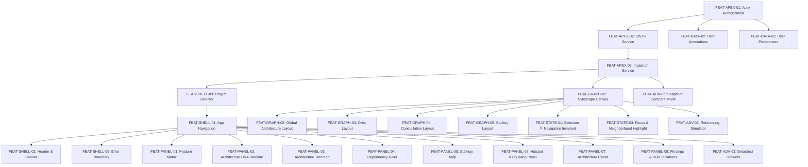

# Full Dependency Analyzer to Salesforce Migration Dependency Map

## 1. Executive Summary & Critical Path Overview

This document details the inter-component dependency relationships, critical path, shared contract boundaries, and parallelization opportunities across all implementation workstreams.

### Critical Path Sequence
```
[External Node.js AST / Exporter (APPROVED_EXTERNAL_SERVICE)]
       │
       ▼
[Apex Security & Data Access Layer (FEAT-APEX-01)] ◄── MANDATORY SECURITY GATE
       │
       ▼
[Apex Payload & Chunk Persistence (FEAT-APEX-02, FEAT-APEX-03)]
       │
       ▼
[LWC Shell & Data Fetcher (daGraphPayloadLoader / daGraphViewer)]
       │
       ▼
[Reusable LWC Layout Engine (daLayoutEngine.js)]
       │
       ├───────────────────────────┬───────────────────────────┐
       ▼                           ▼                           ▼
[Graph Canvas Interactions] [Specialized UI Panels]   [Snapshot Compare Mode]
(Selection != Navigation)   (Matrix, DNA, Subway)     & Analytics Export
       │                           │                           │
       └───────────────────────────┴───────────────────────────┘
                                   │
                                   ▼
                   [Salesforce Org Acceptance & Release]
```

---

## 2. Workstream Ownership & Boundaries

To prevent merge conflicts and double-ownership of shared files, responsibility is explicitly partitioned into 7 distinct workstreams:

| Workstream ID | Workstream Name | Scope & File Boundaries | Lead Responsibilities |
|---|---|---|---|
| **Workstream A** | Application Shell & Project Context | Salesforce App Page, Tab Navigation, `daGraphViewer` outer container, SLDS Header, Project Selector. | Navigation routing, project context switching, view-state coordination. |
| **Workstream B** | Analysis-Service & API Integration | Root AST parsers, Exporter adapter (`scripts/test-export-explorer.cjs`), Ingestion API contracts. | Validating graph schemas, payload normalization, external CLI bridge. |
| **Workstream C** | Graph Payload Contracts & Persistence | `DAGraphChunkService.cls`, `DAGraphIngestionService.cls`, `DA_Graph_Chunk__c`, `DA_User_Preference__c`, `DA_Annotation__c`. | Chunking logic, Apex DTO serialization, SOQL/DML data access security. |
| **Workstream D** | Graph Viewer, Layouts & Interactions | `daGraphViewer` canvas LWC, `daLayoutEngine.js` layout algorithms, Cytoscape integration, Selection/Focus engine. | Graph layout determinism, LOD rendering, enforcing **SELECTION ≠ NAVIGATION** invariant. |
| **Workstream E** | Remaining Application Views & Panels | `daFeatureMatrixPanel`, `daArchitectureDnaBarcode`, `daHotspotPanel`, `daFindingsPanel`, `daRefactoringSimulator`, `daSubwayMap`, `daDependencyRiver`. | Converting specialized React panels into native SLDS LWCs. |
| **Workstream F** | Export, Reporting & Data Correctness | `daSnapshotCompare`, client-side file exporter LWCs, snapshot diff Apex controllers. | Cross-run graph diffing, CSV/JSON/PNG exporter modules. |
| **Workstream G** | Security, Scale, Testing & Integration | Apex unit tests, LWS compliance, static code analysis, performance & memory profiling, release gates. | Security reviews, test coverage enforcement, Salesforce org deployment readiness. |

---

## 3. Detailed Component Dependency Tree (Mermaid)



---

## 4. Shared Contracts and Integration Checkpoints

### 1. Ingestion Payload DTO Contract (`DAGraphDTO.cls` <-> `daGraphPayloadLoader.js`)
- **Format:** JSON structure containing `nodes`, `edges`, `metadata`, and layout parameters.
- **Limit Constraints:** Max total payload = 10MB; Max single chunk = 131,072 characters.
- **Contract Owner:** Workstream C (Server) and Workstream D (Client).

### 2. Layout Coordinate Engine Contract (`daLayoutEngine.js`)
- **Input:** Standardized graph DTO `{ nodes: [...], edges: [...] }` + layout mode string (`global`, `orbit`, `constellation`, `sankey`).
- **Output:** Synchronous node position map `{ [nodeId]: { x: number, y: number } }`.
- **Contract Owner:** Workstream D.

### 3. Selection Context Contract (`SelectionContext` / Reactive LWC Props)
- **Invariant:** `selectedNodeId` updates must ONLY mutate visual highlight classes and panel side-drawers.
- **Rule:** Under no circumstances shall node selection trigger LWC tab navigation or URL route changes.
- **Contract Owner:** Workstream A and Workstream D.

---

## 5. Parallelization Matrix

The following table illustrates workstreams that can run concurrently once prerequisites are met:

| Stage | Concurrent Workstream A | Concurrent Workstream B/C | Concurrent Workstream D | Concurrent Workstream E/F |
|---|---|---|---|---|
| **Phase 1** | App Shell Scaffolding (`FEAT-SHELL-01`) | Chunking & Ingestion Security (`FEAT-APEX-02`, `FEAT-APEX-03`) | Cytoscape LOD Canvas (`FEAT-GRAPH-01`) | — |
| **Phase 2** | Project Selector (`FEAT-SHELL-03`) | User Preferences Apex Service (`FEAT-STATE-02`) | Orbit & Constellation Layouts (`FEAT-GRAPH-03`, `FEAT-GRAPH-04`) | Feature Matrix LWC (`FEAT-PANEL-01`) |
| **Phase 3** | Error Boundary & Alerts (`FEAT-SHELL-05`) | User Annotations Apex (`FEAT-DATA-02`) | Sankey Flow Layout (`FEAT-GRAPH-05`) | Hotspots & Findings Panels (`FEAT-PANEL-06`, `FEAT-PANEL-08`) |
| **Phase 4** | Command Palette Modal (`FEAT-SHELL-04`) | Snapshot Compare Service (`FEAT-ADV-02`) | Advanced Drag/Zoom Policy (`FEAT-STATE-03`) | DNA Barcode, Treemap & Subway panels |
