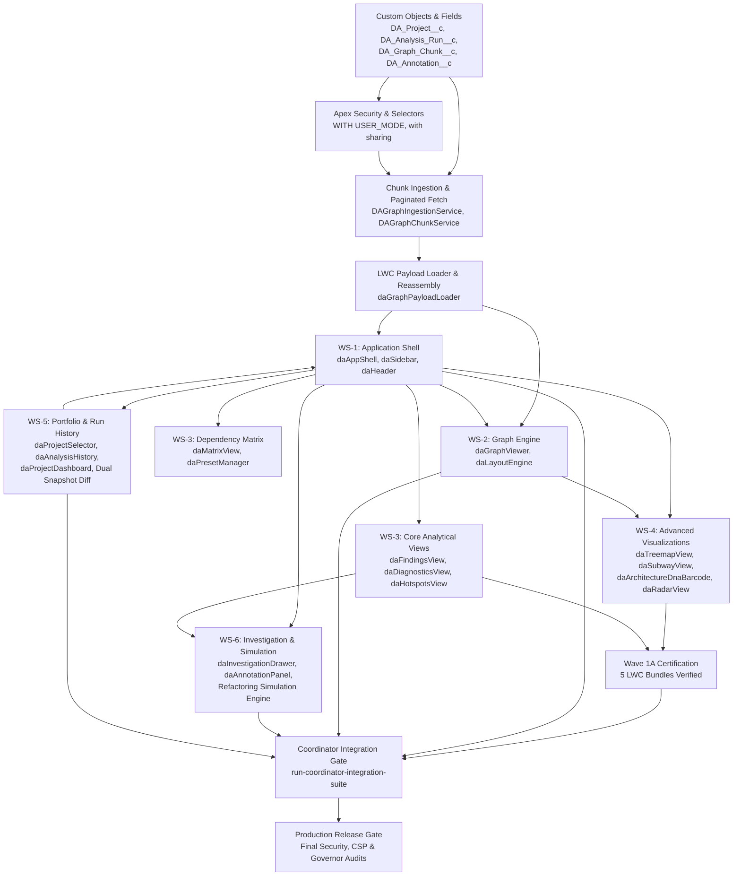

# Cross-Workstream Implementation Dependency Graph

This document visualizes the cross-workstream dependencies, predecessor-successor constraints, parallelization lanes, and integration checkpoints governing the React-to-Salesforce migration.

---

## 1. Directed Acyclic Dependency Graph (Mermaid)

---

## 2. Parallelization Matrix & Lane Assignments

Tasks are partitioned into isolated parallel lanes with non-overlapping file sets:

| Execution Lane | Workstream Focus | Primary Deliverables | Predecessors | Parallelizable With |
| :--- | :--- | :--- | :--- | :--- |
| **Lane A** | **WS-1 (Shell)** | `daAppShell`, `daSidebar`, `daHeader`, `daFilterSchema` | Wave 0 (Loader) | Lane B, Lane C, Lane D, Lane E |
| **Lane B** | **WS-2 (Graph)** | `daGraphViewer`, `daLayoutEngine`, Cytoscape binding | Wave 0 (Loader) | Lane A, Lane C, Lane D, Lane E |
| **Lane C** | **WS-3 (Analytical)** | `daFindingsView`, `daMatrixView`, `daHotspotsView`, `daPresetManager` | Lane A (Shell DTOs) | Lane B, Lane D, Lane E |
| **Lane D** | **WS-4 (Visualizations)** | `daTreemapView`, `daSubwayView`, `daArchitectureDnaBarcode`, `daRadarView` | Lane A, Lane B | Lane C, Lane E |
| **Lane E** | **WS-5 (Portfolio)** | `daProjectSelector`, `daAnalysisHistory`, `daProjectDashboard`, Snapshot Diff | Lane A, Wave 0 | Lane B, Lane C, Lane D |
| **Lane F** | **WS-6 (Investigation)** | `daInvestigationDrawer`, `daAnnotationPanel`, `daRefactoringSimulator` | Lane A, Lane C | Lane B, Lane D, Lane E |

---

## 3. Strict Predecessor-Successor Invariants

1. **Wave 5 Serialization**: Within Workstream 2 (Graph Viewer and Layout Engine), tasks W5-1 through W5-6 must execute in strictly serialized order to maintain Cytoscape canvas lifecycle invariants.
2. **Batch 1 Decoupling**: Certified Batch 1 tasks (W6-2, W6-3, W6-4, W7-1, W7-2) have zero mutual dependencies and can be integrated independently into `daAppShell`.
3. **Fail-Closed Gate Rule**: No downstream consumer view (WS-3, WS-4, WS-6) may be dispatched if the upstream shared payload contract (`daGraphPayloadLoader` / CONTRACT-01) experiences an open regression.
4. **Integration Coordinator Lock**: Merges into protected shell files (`daAppShell.js/html/css`, `daFilterSchema.js`, `run-coordinator-integration-suite.cjs`) are strictly serialized through the Central Integration Coordinator.

---

## 4. Integration Checkpoints

- **Checkpoint 1 (CP-1: Payload & Security)**: Verifies chunk reassembly, UTF-16 surrogate safety, 10 MB cap, and Apex user-mode security (`run-poc-tests.cjs`, `DAGraphSecurityTest.cls`).
- **Checkpoint 2 (CP-2: Shell Invariants & Navigation)**: Confirms `SELECTION ≠ NAVIGATION` invariant, filter propagation, and view switcher state (`run-wave4-integration-suite.cjs`).
- **Checkpoint 3 (CP-3: Wave 1A Visualizations)**: Validates offline test execution for `daTreemapView`, `daSubwayView`, `daHotspotsView`, `daDiagnosticsView`, and `daArchitectureDnaBarcode`.
- **Checkpoint 4 (CP-4: End-to-End Coordination)**: Full integration test suite passing across all 6 workstreams with zero test regressions.
