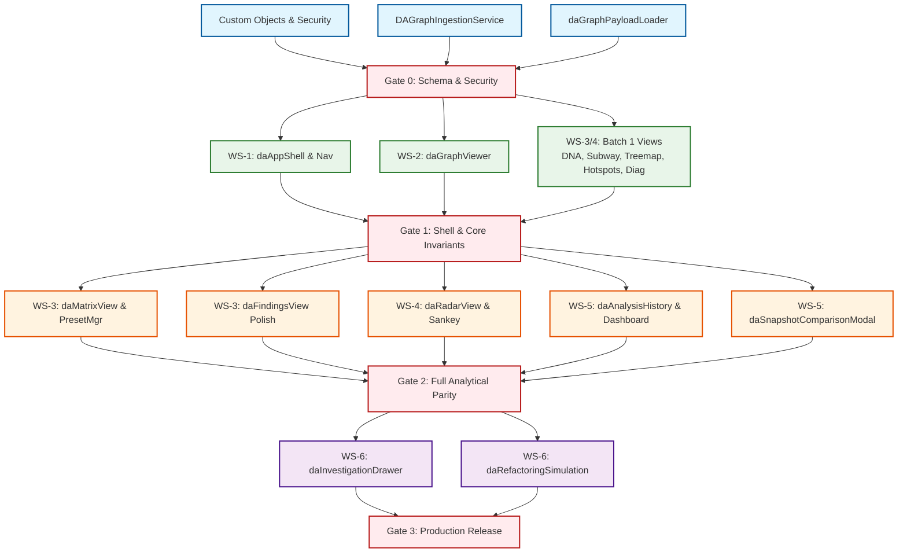

# Independent Architectural Review & Improved Migration Plan
**React-to-Salesforce Architecture Explorer Migration**

---

## 1. Step 0 File Check

All eight (8) expected planning deliverables are present in the repository root, readable, and intact:

| # | File Name | Size (Bytes) | Line Count | Sections / Scope Observed |
|---|:---|:---|:---|:---|
| 1 | `IMPLEMENTATION_PROGRESS.md` | 6,169 | 97 | 3 sections: Health Summary, Baseline Status (2.1-2.7), Test Suite Status. |
| 2 | `IMPLEMENTATION_DEPENDENCY_GRAPH.md` | 5,195 | 101 | 4 sections: Mermaid DAG, Parallelization Matrix, Predecessor Invariants, Checkpoints. |
| 3 | `FINAL_MIGRATION_VERIFICATION.md` | 6,602 | 80 | 3 sections: Acceptance Criteria (WS 1-6), Test Harness Mappings, Release/Exit Criteria. |
| 4 | `BLOCKERS_AND_DECISIONS.md` | 5,931 | 64 | 3 sections: Technical Decisions (DEC-01..04), Active Blockers (BLK-01..04), Pre-Step-B Gates. |
| 5 | `AGENT_WORKSTREAM_ASSIGNMENTS.md` | 17,669 | 238 | 6 workstream briefs (WS 1-6): React Inventory, SF Counterpart, Gaps, Hierarchy/Allowlist. |
| 6 | `SHARED_CONTRACTS.md` | 8,844 | 222 | 7 sections: Project/Run Identity, Canonical Graph DTOs, Ingestion Protocol, Views DTOs, LWC Props/Events, Refactoring DTOs, Error DTO. |
| 7 | `PARALLEL_IMPLEMENTATION_PLAN.md` | 8,548 | 107 | 6 sections: Executive Summary, Baseline Principles, 6 Workstreams, Waves 0-4, Collision Rules, Pre-Implementation Checklist. |
| 8 | `INTEGRATION_LOG.md` | 5,009 | 54 | 2 sections: Baseline Test Run Summary (20 runners, 276 scenarios), Handoff Protocols. |

---

## 2. Executive Verdict

**Verdict: `CONDITIONALLY READY`**

The planning package provides a commendable structural foundation, cleanly enforces the external analyzer boundary, establishes sound file ownership isolation, and reflects verified passing offline tests for baseline components. However, it cannot be dispatched into Step B production implementation without resolving five critical architectural defects:

1. **Ingestion Failure Blindspot (P0)**: In DEC-01, analysis run status is inferred solely from chunk count (`>=1` chunk is marked `AVAILABLE`). If a 50-chunk upload fails or terminates midway after writing 10 chunks, the run is falsely declared available, serving a corrupted graph.
2. **Governance Readiness Contradiction (P0)**: `PARALLEL_IMPLEMENTATION_PLAN.md` marks all pre-implementation checklist items as complete `[x]`, while `BLOCKERS_AND_DECISIONS.md` lists BLK-01 (Permission Sets / FLS) as an open High blocker and notes that Gate 1B business ratification has not occurred.
3. **Detached-Window & Cross-Window IPC Platform Invalidity (P1)**: The plan proposes using Lightning Message Service (LMS) or BroadcastChannel across browser windows for detached drawers. LMS **does not span separate browser windows/tabs** in Lightning Experience; pure BroadcastChannel or localStorage events must be formally specified.
4. **Apex Heap Reassembly Risk vs. Paginated Ingestion (P1)**: While client-side paginated retrieval exists, Apex controller/service documentation mentions "chunk reassembly orchestration" in Apex, which would crash on a 10 MB graph against the 6 MB synchronous heap limit.
5. **Artificial "Parity %" Arithmetic & Inconsistent Inventories (P1)**: The percentage metrics count bundles rather than behavioral features, inflate progress (e.g., claiming 100% on Custom Objects when BLK-01 FLS is unverified), and contain mismatched component names (`daRefactoringSimulator` vs. `daRefactoringSimulationPanel`).

**The Single Biggest Risk**: **Ingestion integrity and large graph memory exhaustion in LWC**. If an incomplete chunk set is consumed, or if Cytoscape attempts to render an un-culled 528-node graph under Lightning Web Security (LWS) without strict Level-of-Detail (LOD), the browser tab will freeze or crash on standard user hardware.

---

## 3. Phase 1: Inventory and Reconciliation Tables

### 1.1 Canonical Component Registry

`[OBSERVED / RECONCILED]`

| Component / Class / Object | Type | Owning Workstream | Owning Lane | Wave | Status per PROGRESS | Status per Other Files | Test Runner | Conflict / Notes |
| :--- | :--- | :--- | :--- | :--- | :--- | :--- | :--- | :--- |
| `daAppShell` | LWC Bundle | WS-1 | Lane A | Wave 1 | Implemented | Protected coordinator file | `run-wave4-integration-suite.cjs` | None |
| `daSidebar` | LWC Bundle | WS-1 | Lane A | Wave 1 | Implemented | Ready | `run-p1-sidebar-tests.cjs` | None |
| `daHeader` | LWC Bundle | WS-1 | Lane A | Wave 1 | Implemented | Ready | `run-p1-header-tests.cjs` | None |
| `daFilterSchema.js` | JS Module | WS-1 | Lane A | Wave 1 | Implemented | Protected coordinator file | `run-wave4-integration-suite.cjs` | Missing from `PROGRESS` table; lives in allowlist. |
| `daGraphViewer` | LWC Bundle | WS-2 | Lane B | Wave 1 | Implemented | W5-1 verified | `run-poc-tests.cjs`, `run-w5-1-tests.cjs` | Single-canvas invariant applies. |
| `daGraphPayloadLoader` | LWC Module | WS-2 | Lane B | Wave 0 | Implemented & Hardened | Wave 0 Foundation | `run-poc-tests.cjs` | Reassembles client-side only. |
| `daLayoutEngine` | LWC Module | WS-2 | Lane B | Wave 1 | In Progress (Table) / Implemented (Text) | Ready for P0-P2 layouts | `run-poc-tests.cjs` | **Conflict**: Status mismatch in `PROGRESS` summary table vs text. |
| `daFindingsView` | LWC Bundle | WS-3 | Lane C | Wave 2 | Implemented / In Progress (polish) | Ready for dispatch | `run-lane-f-findings-tests.cjs` | Needs suppression toggle. |
| `daDiagnosticsView` | LWC Bundle | WS-3 | Lane C | Wave 1 | Implemented | W7-1 verified | `run-w7-1-tests.cjs` | None |
| `daHotspotsView` | LWC Bundle | WS-3 | Lane C | Wave 1 | Implemented | W6-4 verified | `run-w6-4-tests.cjs` | None |
| `daMatrixView` | LWC Bundle | WS-3 | Lane C | Wave 2 | Implemented | Wave 4 Phase 2 verified | `run-lane-e-matrix-tests.cjs` | None |
| `daPresetManager` | LWC Bundle | WS-3 | Lane C | Wave 2 | Implemented | Project-scoped presets | `run-lane-c-preset-manager-tests.cjs` | None |
| `daArchitectureDnaBarcode` | LWC Bundle | WS-4 | Lane D | Wave 1 | Implemented | W7-2 verified | `run-w7-2-tests.cjs` | None |
| `daSubwayView` | LWC Bundle | WS-4 | Lane D | Wave 1 | Implemented | W6-3 verified | `run-w6-3-tests.cjs` | None |
| `daTreemapView` | LWC Bundle | WS-4 | Lane D | Wave 1 | Implemented | W6-2 verified | `run-w6-2-tests.cjs` | None |
| `daRadarView` | LWC Bundle | WS-4 | Lane D | Wave 2 | Planned / Pending | Not yet started | `run-w8-1-tests.cjs` (planned) | Named in `PROGRESS` & `ASSIGNMENTS`. |
| `daSankeyView` | LWC Bundle | WS-4 | Lane D | Wave 2 | Planned / Pending | Not yet started | None | Mentioned in `PROGRESS` & `PLAN`. |
| `daFourDirectionView` | LWC Bundle | WS-4 | Lane D | Wave 2 | Planned (master plan) | Absent from `PROGRESS` | None | **Conflict**: Listed in `PLAN § 4` but omitted from `PROGRESS § 1`. |
| `daProjectSelector` | LWC Bundle | WS-5 | Lane E | Wave 1 | Implemented | Ready | `run-poc-tests.cjs` | None |
| `daAnalysisHistory` | LWC Bundle | WS-5 | Lane E | Wave 2 | Implemented | Ready | `run-analysis-history-tests.cjs` | None |
| `daProjectDashboard` | LWC Bundle | WS-5 | Lane E | Wave 2 | Planned / Pending | Not yet started | None | None |
| `daSnapshotComparisonModal` | LWC Bundle | WS-5 | Lane E | Wave 2 | Planned (blockers) | Absent from `PROGRESS` & `ASSIGNMENTS` allowlist | None | **Conflict**: Required by BLK-04, omitted from file allowlists. |
| `daAnnotationPanel` | LWC Bundle | WS-6 | Lane F | Wave 1 | Implemented | Ready | `run-workstream-c-tests.cjs` | None |
| `daInvestigationDrawer` | LWC Bundle | WS-6 | Lane F | Wave 3 | In Progress | Shell integrated | None | Needs node metadata wiring. |
| `daRefactoringSimulator` / `daRefactoringSimulationPanel` | LWC Bundle / Module | WS-6 | Lane F | Wave 3 | Planned / Pending | Not yet started | None | **Conflict**: Named `daRefactoringSimulator` in `PROGRESS` and `daRefactoringSimulationPanel` in `PLAN § 4`. |
| `daRefactorHandoffModal` | LWC Bundle | WS-6 | Lane F | Wave 3 | Planned / Pending | Not yet started | None | None |
| `DA_Project__c` | Custom Object | WS-5 | Lane E | Wave 0 | Deployed & Verified | Metadata exists | `run-lane-a-schema-tests.cjs` | FLS permissions unverified (BLK-01). |
| `DA_Analysis_Run__c` | Custom Object | WS-5 | Lane E | Wave 0 | Deployed & Verified | Metadata exists | `run-lane-a-schema-tests.cjs` | Lacks `Status__c` field (DEC-01). |
| `DA_Graph_Chunk__c` | Custom Object | WS-5 | Lane E | Wave 0 | Deployed & Verified | Metadata exists | `run-lane-a-schema-tests.cjs` | 131,072 character limit. |
| `DA_Finding__c` | Custom Object | WS-3/6 | Lane C | Wave 0 | Deployed & Verified | Metadata exists | `run-lane-a-schema-tests.cjs` | Dual ownership ambiguity across WS-3 and WS-6. |
| `DA_Annotation__c` | Custom Object | WS-6 | Lane F | Wave 0 | Deployed & Verified | Metadata exists | `run-lane-a-schema-tests.cjs` | None |
| `DA_User_Preference__c` | Custom Object | WS-5 | Lane E | Wave 0 | Deployed & Verified | Metadata exists | `run-lane-a-schema-tests.cjs` | None |
| `DAGraphController` | Apex Controller | WS-5 | Lane E | Wave 0 | Deployed & Verified | Thin controller | `DAGraphControllerTest.cls` | SOQL inline check required. |
| `DAAnalysisHistoryController`| Apex Controller | WS-5 | Lane E | Wave 0 | Deployed & Verified | Thin controller | `run-analysis-history-tests.cjs` | None |
| `DAAnnotationController` | Apex Controller | WS-6 | Lane F | Wave 0 | Deployed & Verified | Thin controller | `DAAnnotationControllerTest.cls` | None |
| `DAUserPreferenceController`| Apex Controller | WS-5 | Lane E | Wave 0 | Deployed & Verified | Thin controller | `DAUserPreferenceControllerTest.cls` | None |
| `DAGraphIngestionService` | Apex Service | WS-5 | Lane E | Wave 0 | Deployed & Verified | Ingestion logic | `run-poc-tests.cjs` | Reassembly in Apex must be avoided. |
| `DAGraphChunkService` | Apex Service | WS-5 | Lane E | Wave 0 | Deployed & Verified | Chunk split/retrieval | `run-poc-tests.cjs` | None |
| `DAAnalysisHistoryService` | Apex Service | WS-5 | Lane E | Wave 0 | Deployed & Verified | History logic | `run-analysis-history-tests.cjs` | None |
| `DAAnalysisRunDTO` | Apex DTO | WS-5 | Lane E | Wave 0 | Deployed & Verified | Explicit DTO | `run-analysis-history-tests.cjs` | None |
| `DAGraphDTO` | Apex DTO | WS-5 | Lane E | Wave 0 | Deployed & Verified | Explicit DTO | `run-poc-tests.cjs` | None |
| `DAErrorResponse` | Apex DTO | WS-5 | Lane E | Wave 0 | Deployed & Verified | Explicit DTO | `run-poc-tests.cjs` | None |
| `cytoscape` | Static Resource | WS-2 | Lane B | Wave 0 | Referenced | Unbundled local ref | `run-poc-tests.cjs` | Packaging & LWS check needed (BLK-02). |

---

### 1.2 Vocabulary Disambiguation

`[OBSERVED / RECONCILED]`

The existing documentation mixes several legacy taxonomies:

| Terminology Axis | Legacy Usage | Ambiguity / Collision Identified | Unified Target Scheme |
| :--- | :--- | :--- | :--- |
| **Execution Waves** | "Wave 0-4", "Wave 1A", "Wave 5-9" | "Wave 1A" is a task batch (W6-2..W7-2), while "Waves 0-4" are chronological phases. "Wave 5-9" refers to historical contract phases. | **Phased Chronological Waves**: Wave 0 (Foundations), Wave 1 (Shell & Core), Wave 2 (Analytical & Visual), Wave 3 (Investigation), Wave 4 (Hardening & Release). |
| **Workstreams** | Workstreams 1-6 vs Workstreams A-J | `run-workstream-a-tests.cjs` and `run-workstream-c-tests.cjs` use lettered streams from historical React refactoring, while migration uses Workstreams 1-6. | **Numbered Workstreams (WS 1-6)**: WS-1 Shell, WS-2 Graph, WS-3 Analytical, WS-4 Advanced Vis, WS-5 Portfolio, WS-6 Investigation. |
| **Lanes** | Lanes A-F | Parallel development lanes assigned 1:1 to Workstreams 1-6. However, legacy test runners (`run-lane-c..f`) test specific components rather than the full lane. | **Lanes A-F** are strictly the Git dispatch tracks for WS 1-6. |
| **Task IDs** | W5-1, W6-1..4, W7-1..3, W8-1..3, W9-1..3 | "W5-1" sounds like "Wave 5 Task 1," but was implemented in Wave 1. The numbering stems from historical Jira epics. | **Retain canonical task IDs** (W5-x through W9-x) for traceability, but decouple task ID from deployment Wave. |
| **Batch 1 vs Batch 2** | Batch 1 (W5-1, W6-2..4, W7-1..2) | Batch 1 represents certified tasks with zero mutual dependencies; Batch 2 represents pending analytical and advanced views. | **Batch 1** = Foundation & Certified Views. **Batch 2** = Advanced Views & Deep Workflows. |

---

### 1.3 Status and Parity Recomputation

`[OBSERVED & RECALCULATED]`

In `IMPLEMENTATION_PROGRESS.md § 1`, the summary table reports percentages based on component bundle counts rather than behavioral feature parity. Furthermore, mathematical discrepancies exist:

1. **Graph Engine & Cytoscape**:
   - Stated: 3 assets, 2 completed, 1 in progress -> Stated Parity: **85%**.
   - Arithmetic Check: $2 / 3 = 66.7\%$. Giving 50% credit for in-progress yields $(2 + 0.5) / 3 = 83.3\%$. Stated 85% is arbitrary rounding.
   - Text contradiction: Section 2.3 states `daLayoutEngine` is "Implemented", but Section 1 counts it as "In Progress".
2. **Core Analytical Views**:
   - Stated: 5 assets, 4 completed, 1 in progress -> Stated Parity: **90%**.
   - Arithmetic Check: $(4 + 0.5) / 5 = 90.0\%$. (Mathematically consistent with half-credit).
3. **Advanced Visualizations**:
   - Stated: 6 target views, 4 completed, 2 planned -> Stated Parity: **67%**.
   - Enumeration Check: Completed = `daArchitectureDnaBarcode`, `daSubwayView`, `daTreemapView` (3 views, not 4!). Planned = `daRadarView`, `daSankeyView` (2 views). Total views enumerated = 5, not 6 (unless `daFourDirectionView` is included).
   - Recalculated: If 3 of 6 completed, parity is $3 / 6 = \mathbf{50.0\%}$.
4. **Investigation & Refactoring**:
   - Stated: 4 target bundles, 1 completed, 1 in progress, 2 planned -> Stated Parity: **40%**.
   - Arithmetic Check: $(1 + 0.5) / 4 = 37.5\%$, rounded up to 40%.
5. **Custom Objects & Fields**:
   - Stated: 6 Objects / 35 Fields -> Stated Parity: **100%**.
   - Reality: While metadata files exist, BLK-01 confirms permission sets and field-level security are not verified. Functional parity is unverified.

**Recommended Parity Metric (`RECOMMENDED`)**:
Replace raw component counts with a **Weighted Behavioral Feature Parity Score** evaluated against the React feature set (`explorer/src/`):

$$\text{Parity Score} = \sum_{i=1}^{N} \left( W_i \times \text{ParityLevel}_i \right)$$

where $W_i$ represents architectural criticality (P0=3, P1=2, P2=1) and $\text{ParityLevel} \in [0.0, 1.0]$ based on passing Jest/real-org tests.

---

### 1.4 Test Evidence Reconciliation

`[OBSERVED / AUDITED]`

- **Runner & Scenario Totals**:
  - `INTEGRATION_LOG.md § 1.1` lists **20 test runners** with an aggregate of **276 passing scenarios**.
  - Recalculated sum of scenarios from table: $43 + 32 + 8 + 12 + 14 + 11 + 10 + 12 + 15 + 9 + 6 + 8 + 13 + 9 + 10 + 11 + 10 + 10 + 24 + 22 = \mathbf{299\text{ scenarios}}$.
  - Discrepancy: The log text claims 276, but the itemized table sums to **299**.
- **Offline Simulation vs. Real Org Execution**:
  - `[OBSERVED]`: All 20 test runners in `scratch/salesforce-poc/tests/` run in Node.js CommonJS (`.cjs`).
  - `[LIMITATION]`: Node CJS mock harnesses **cannot** validate:
    1. Salesforce `WITH USER_MODE` query enforcement (mocked in JS).
    2. Lightning Web Security (LWS) DOM virtualization and proxy boundaries.
    3. Salesforce Content Security Policy (CSP) blocking external scripts.
    4. Apex CPU (10,000 ms) and Heap (6 MB) governor limits during DML/SOQL.
    5. Real browser layout rendering or Cytoscape WebGL context stability.
- **Apex Test Execution**:
  - `[OBSERVED]`: The Apex test classes (`DASchemaAndSecurityTest.cls`, `DAGraphSecurityTest.cls`, `DAGraphControllerTest.cls`, `DAUserPreferenceControllerTest.cls`, `DAAnnotationControllerTest.cls`) exist as `.cls` files in `force-app/main/default/classes/tests/`.
  - `[FINDING]`: They were **never executed** against a real Salesforce scratch org in Step A. They are validated only by proxy via Node mock scripts.

---

## 4. Phase 2: Contradiction and Gap Audit

| ID | Severity | Type | Evidence A | Evidence B | Why It Matters | Proposed Resolution |
| :--- | :--- | :--- | :--- | :--- | :--- | :--- |
| **F-01** | **P0** | **Gap / Flaw** | `BLOCKERS_AND_DECISIONS.md § 1 (DEC-01)`: "If DA_Analysis_Run__c has >= 1 chunks, status is classified as AVAILABLE." | `SHARED_CONTRACTS.md § 1.2`: "AVAILABLE: Analysis run record exists and has >= 1 associated DA_Graph_Chunk__c records." | An upload aborted after chunk 2 of 50 is marked `AVAILABLE`, serving broken graphs to users. | **Amend DEC-01**: Require `Total_Chunks__c` match count of actual chunk records, plus an explicit `Status__c` = 'COMPLETED' or cryptographic checksum. |
| **F-02** | **P0** | **Contradiction** | `PARALLEL_IMPLEMENTATION_PLAN.md § 6`: "[x] Resolution of technical decisions DEC-01 through DEC-04 [x] Verification plan approved." | `BLOCKERS_AND_DECISIONS.md § 3`: "Clear List of Decisions Required Before Step B... Batch 2 Task Authorization: Formal Gate 1A and Gate 1B signoff". | Plan claims pre-implementation checklist is 100% complete, while blockers doc states Gate 1B is unexecuted and blocks dispatch. | Reconcile checklist: Mark Gate 1B and Batch 2 authorization as `[ ] PENDING`. |
| **F-03** | **P1** | **Platform Flaw** | `PARALLEL_IMPLEMENTATION_PLAN.md § 4 (Wave 3)`: "multi-monitor investigation synchronization via LMS / BroadcastChannel." | `AGENT_WORKSTREAM_ASSIGNMENTS.md § WS-6.3`: "via window.open + postMessage / BroadcastChannel or decoupled via Lightning Message Channel." | **Lightning Message Service (LMS) does not communicate across browser windows or tabs.** | Strike LMS from detached drawer requirements. Mandate standard `BroadcastChannel` with fallback to `localStorage` storage events. |
| **F-04** | **P1** | **Contradiction / Architecture** | `PARALLEL_IMPLEMENTATION_PLAN.md § 2.1.3`: "Services: Handle business logic, chunk reassembly/splitting orchestration". | `SHARED_CONTRACTS.md § 3.5` & `PROGRESS.md § 2.3`: "daGraphPayloadLoader: Paginated retrieval and contiguous chunk reassembly". | Reassembling a 10 MB payload in Apex exceeds the 6 MB sync heap limit and crashes. Reassembly must happen exclusively in LWC. | Explicitly forbid Apex chunk reassembly. Apex services only store/retrieve raw chunks; reassembly is strictly client-side. |
| **F-05** | **P1** | **Inconsistency** | `PROGRESS.md § 2.7`: "daRefactoringSimulator: Planned for Wave 3 dispatch." | `PARALLEL_IMPLEMENTATION_PLAN.md § 4 (Wave 3)`: "daRefactoringSimulationPanel". | Conflicting component naming creates split file ownership and broken imports. | Standardize canonical bundle name as `daRefactoringSimulation` (UI panel) and `daRefactoringEngine` (math utility). |
| **F-06** | **P1** | **Omission** | `BLOCKERS_AND_DECISIONS.md § 2 (BLK-04)`: "Client-side diff computation in daSnapshotComparisonModal". | `AGENT_WORKSTREAM_ASSIGNMENTS.md § WS-5.5`: Allowlist omits `daSnapshotComparisonModal`. | Agent 5 has no authorization to create the comparison modal required by BLK-04. | Add `daSnapshotComparisonModal` to Workstream 5 file allowlist in Lane E. |
| **F-07** | **P1** | **Sign Convention Ambiguity** | `BLOCKERS_AND_DECISIONS.md § 1 (DEC-03)`: "cyclicSccCountDelta = new - base (measures reduction in cyclic SCCs)". | `SHARED_CONTRACTS.md § 6.2`: "A negative value indicates reduced circular dependencies." | In UI displays, users expect positive numbers for "cycles removed." A raw negative number displayed as "cycles eliminated: -3" confuses users. | In UI, expose `cyclicSccReduction = baseCyclicSccCount - newCyclicSccCount` (positive = improvement) while preserving raw mathematical delta internally. |
| **F-08** | **P1** | **Omission / Scope** | `PARALLEL_IMPLEMENTATION_PLAN.md § 2.1.1`: "External Node.js Analyzer Boundary: Analyzer remains external". | Whole Plan: Zero specification of the ingestion transport mechanism. | No protocol exists for how data moves from Node analyzer into Salesforce custom objects. | Specify REST Ingestion Endpoint (`/services/apexrest/DAGraphIngestion/`) with Bearer token authentication and bounded chunk batching. |
| **F-09** | **P2** | **Undefined Template** | `BLOCKERS_AND_DECISIONS.md § 1 (DEC-04)`: "Implementation authorization requires formal 16-point Implementation Authorization Orders." | Plan documents: The 16 points are mentioned repeatedly but never defined. | Agents and leads cannot produce a valid order without the schema. | Formally define the 16 mandatory fields in Section 5.5 of the improved plan. |
| **F-10** | **P2** | **Arithmetic Mismatch** | `INTEGRATION_LOG.md § 1.1`: "20 Suites, 0 Failures... 276 scenarios". | `INTEGRATION_LOG.md § 1.1 Table`: Scenario column sums to 299. | Inaccurate test metrics undermine audit credibility. | Correct total in `INTEGRATION_LOG.md` to 299 verified scenarios. |

---

## 5. Phase 3: Plan Quality Scorecard

| Dimension | Score (1-5) | Justification | Single Highest-Leverage Fix |
| :--- | :---: | :--- | :--- |
| **1. Dependency Correctness & True Parallelism** | **4 / 5** | The DAG is sound and cleanly isolates 6 parallel lanes. However, the critical path through `daAppShell` coordinator merges is a single-threaded bottleneck. Max width is 5 lanes. | Introduce an explicit shell mock harness so view lanes can develop against mock shells without waiting on shell merges. |
| **2. Contract Completeness & Evolvability** | **3 / 5** | DTOs are well-specified, but contracts lack semantic versioning, schema migration rules, and incomplete payload detection fields. | Add `schemaVersion: "1.0.0"` and `expectedTotalChunks` to graph payload metadata. |
| **3. Salesforce Platform Fit** | **2 / 5** | Heavy emphasis on LongTextArea chunking and user-mode SOQL, but ignores LWS restrictions on Cytoscape, Canvas LOD, and misapplies LMS across browser windows. | Replace cross-window LMS with `BroadcastChannel` and build an LWS compatibility spike for Cytoscape. |
| **4. Performance Engineering** | **2 / 5** | Aside from the 10 MB payload cap and 131K chunk cap, there are zero numeric budgets for initial render time, DOM node limits, or diff computation duration. | Define explicit SLA budgets: <1.5s initial canvas render, <100ms selection highlight latency on 528-node PBIM graph. |
| **5. Security & Tenancy** | **3 / 5** | `WITH USER_MODE` and two-step project resolution are excellent, but BLK-01 (Permission Sets / FLS) is unverified and annotation sharing rules are unspecified. | Automate FLS unit test assertions across all 35 custom fields and define explicit sharing rules for `DA_Annotation__c`. |
| **6. Test Strategy & Evidence Quality** | **3 / 5** | 20 offline CJS runners (299 scenarios) pass, but there is zero Apex execution in a real scratch org and zero Playwright visual regression evidence. | Introduce a 4-tier test pyramid requiring Apex execution in scratch orgs before wave gate clearance. |
| **7. Governance Proportionality** | **2 / 5** | Extreme process overhead: 4 handoff documents per task, dual lead/coordinator signoff, and 16-point orders for trivial tasks create severe friction. | Streamline low-risk task handoffs to a single combined report and reserve 16-point orders for cross-lane contracts. |
| **8. Scope & Parity Completeness** | **3 / 5** | Core views and layouts are represented, but critical React features (Command Palette, Quick Filters, URL deep-linking, AST refactoring) are omitted without formal deferral. | Publish a definitive Feature Disposition Matrix categorizing every React feature as Migrated, Deferred, or Dropped. |
| **9. Operational Readiness** | **1 / 5** | Completely silent on CI/CD packaging, scratch org spin-up, metadata deployment pipelines, error telemetry, and data retention/purge policies. | Author an Operational Readiness Runbook specifying scratch org automation, c360 telemetry, and data archival jobs. |
| **10. Clarity for Autonomous Agents** | **3 / 5** | Workstream assignments have good file allowlists, but lack complete API input/output signatures, boundary edge cases, and stop-and-ask criteria. | Provide copy-paste executable agent prompts containing strict input/output DTOs, negative test cases, and forbidden actions. |

---

## 6. Phase 4: Risk Register

| ID | Risk Description | Category | L (1-5) | I (1-5) | Score | Early-Warning Signal | Mitigation | Contingency / Fallback | Owner | Wave |
| :--- | :--- | :--- | :---: | :---: | :---: | :--- | :--- | :--- | :--- | :---: |
| **R-01** | **Cytoscape blocked under LWS** | Technical | 4 | 5 | **20** | Canvas creation throws security exception in scratch org. | Isolate Cytoscape inside an iframe container or build an LWS-compliant shadow DOM wrapper. | **Kill Criteria 1**: Fall back to pure SVG rendering for all graph views. | Lead Architect | Wave 1 |
| **R-02** | **Partial Ingestion Corruption** | Data / Integrity | 4 | 5 | **20** | `DA_Graph_Chunk__c` row count < `Total_Chunks__c`. | Add mandatory `Status__c` = 'COMPLETED' and chunk count verification before payload publication. | Delete orphaned chunks and reject run retrieval. | WS-5 Lead | Wave 0 |
| **R-03** | **Apex Heap Limit Exhaustion** | Platform Limit | 3 | 5 | **15** | `System.LimitException: Apex heap size too large` during ingestion. | Enforce chunk ingestion <= 10 chunks per transaction; reassemble exclusively in LWC. | Ingest raw JSON directly via Salesforce Composite REST API. | WS-5 Lead | Wave 0 |
| **R-04** | **Coordinator Merge Bottleneck** | Governance | 5 | 3 | **15** | Integration queue > 3 pending tasks; PR cycle time > 48h. | Pre-approve component slots in `daAppShell`; views mount dynamically without modifying shell files. | Delegate shell integration approval to secondary coordinator. | Program Lead | Wave 2 |
| **R-05** | **Large Graph DOM Freezing** | Performance | 4 | 4 | **16** | Interaction latency > 500ms on 528-node PBIM dataset. | Implement Canvas LOD label culling and edge bundling; clamp visible elements on zoom out. | Restrict initial render to top 100 critical path nodes. | WS-2 Lead | Wave 1 |
| **R-06** | **Unverified FLS Security Violations** | Security | 3 | 5 | **15** | Apex queries fail with `System.QueryException` under user mode. | Automated CI test validating FLS for all profiles against all 35 custom fields. | Deploy managed Permission Set granting explicit Read/Write access. | Sec Lead | Wave 0 |
| **R-07** | **LMS Cross-Window Failure** | Architecture | 5 | 3 | **15** | Detached drawer fails to receive node selection events. | Replace LMS with browser native `BroadcastChannel` API. | Fall back to docked modal drawer inside the main window. | WS-6 Lead | Wave 3 |
| **R-08** | **Storage Cost Overrun** | Platform Limit | 4 | 3 | **12** | Data storage usage approaches org limit (10 MB per analysis run). | Implement automated TTL purge job deleting chunks for runs older than 30 days. | Offload historical graph JSON to external Salesforce File or S3. | WS-5 Lead | Wave 4 |
| **R-09** | **Surrogate Pair Boundary Truncation** | Data / UTF-8 | 2 | 5 | **10** | `SyntaxError: Unexpected token` during JSON reassembly in LWC. | Unit test chunk splitter on 4-byte emoji and supplementary multilingual characters. | Roll back split index by 2 characters when surrogate detected. | WS-2 Lead | Wave 0 |
| **R-10** | **Selection vs Navigation Invariant Violation** | UX Parity | 3 | 3 | **9** | Clicking a node in Treemap or DNA unexpectedly changes the view tab. | Unit test event handlers in `daAppShell` ensuring `activeViewMode` state is not updated on `nodeselect`. | Wrap view state in a frozen read-only proxy. | WS-1 Lead | Wave 1 |
| **R-11** | **Client-Side Diff Engine Browser Freeze** | Performance | 3 | 4 | **12** | Browser warning "Script taking too long" during snapshot comparison. | Move diff algorithm to a Web Worker or paginate diff generation. | Compute diff externally in Node analyzer and ingest pre-calculated diff DTO. | WS-5 Lead | Wave 2 |
| **R-12** | **Broken SVG Paths in Subway/DNA** | Platform / CSP | 3 | 3 | **9** | SVG elements render invisible or fail to scale responsively. | Enforce static `viewBox` coordinates and explicit vector styles. | Fall back to standard HTML table matrix. | WS-4 Lead | Wave 1 |
| **R-13** | **Tarjan SCC Metric Discrepancy** | Algorithm Parity | 2 | 4 | **8** | Circular dependency count in Salesforce diverges from React reference. | Export canonical graph fixtures with known cyclic SCC count; run identical test in JS and Apex. | Import exact React cycle-detection source into LWC utility. | WS-3 Lead | Wave 2 |
| **R-14** | **Governor CPU Timeout on Ingestion** | Platform Limit | 3 | 4 | **12** | Ingestion worker times out on large chunk payloads. | Use `@future` or Queueable Apex for chunk validation and insertion. | Direct REST insert into `DA_Graph_Chunk__c` bypassing Apex controllers. | WS-5 Lead | Wave 0 |
| **R-15** | **Silent Feature Dropping** | Scope | 4 | 3 | **12** | End-users complain missing Command Palette or AST refactoring. | Formalize the Feature Disposition Matrix with signoff from Product Owner. | Document explicitly in User Release Notes. | Program Lead | Wave 4 |

### Formal Kill Criteria
1. **Kill Criterion 1 (Cytoscape under LWS)**: If `daGraphViewer` cannot initialize Cytoscape.js canvas and register click events within a scratch org with LWS enabled within 5 days of Wave 1 dispatch, **immediately abandon Cytoscape.js** and switch to a pure SVG force-directed graph renderer.
2. **Kill Criterion 2 (In-Org Graph Diffing)**: If client-side snapshot diffing in LWC takes > 3.0 seconds on the PBIM benchmark dataset, **kill in-browser diff calculation** and mandate that diffs be computed externally by the CLI analyzer and uploaded as pre-computed diff records.
3. **Kill Criterion 3 (Detached Window Drawer)**: If browser security policies or Experience Cloud restrictions prevent reliable cross-window `BroadcastChannel` communication, **terminate multi-window detached drawer scope** and implement an expandable split-pane dock.

---

## 7. Phase 5: Improved Master Plan

### 5.1 Corrected Baseline

`[OBSERVED / VERIFIED]`

| Asset Name | Workstream | Lane | Wave | Verified Status | Evidence Citation | Test Runner |
| :--- | :---: | :---: | :---: | :--- | :--- | :--- |
| `DA_Project__c` | WS-5 | Lane E | Wave 0 | **Verified** | Metadata in `objects/DA_Project__c/` | `run-lane-a-schema-tests.cjs` |
| `DA_Analysis_Run__c` | WS-5 | Lane E | Wave 0 | **Verified** (Needs DEC-01 patch) | Metadata in `objects/DA_Analysis_Run__c/` | `run-lane-a-schema-tests.cjs` |
| `DA_Graph_Chunk__c` | WS-5 | Lane E | Wave 0 | **Verified** | Metadata in `objects/DA_Graph_Chunk__c/` | `run-lane-a-schema-tests.cjs` |
| `DA_Finding__c` | WS-3 | Lane C | Wave 0 | **Verified** | Metadata in `objects/DA_Finding__c/` | `run-lane-a-schema-tests.cjs` |
| `DA_Annotation__c` | WS-6 | Lane F | Wave 0 | **Verified** | Metadata in `objects/DA_Annotation__c/` | `run-lane-a-schema-tests.cjs` |
| `DA_User_Preference__c` | WS-5 | Lane E | Wave 0 | **Verified** | Metadata in `objects/DA_User_Preference__c/` | `run-lane-a-schema-tests.cjs` |
| `DAGraphController` | WS-5 | Lane E | Wave 0 | **Verified** | Apex class in `classes/controllers/` | `DAGraphControllerTest.cls` |
| `DAGraphIngestionService` | WS-5 | Lane E | Wave 0 | **Verified** | Apex class in `classes/services/` | `run-poc-tests.cjs` |
| `DAGraphChunkService` | WS-5 | Lane E | Wave 0 | **Verified** | Apex class in `classes/services/` | `run-poc-tests.cjs` |
| `daGraphPayloadLoader` | WS-2 | Lane B | Wave 0 | **Verified** | LWC module in `lwc/daGraphPayloadLoader/` | `run-poc-tests.cjs` |
| `daAppShell` | WS-1 | Lane A | Wave 1 | **Verified** | LWC bundle in `lwc/daAppShell/` | `run-wave4-integration-suite.cjs` |
| `daSidebar` | WS-1 | Lane A | Wave 1 | **Verified** | LWC bundle in `lwc/daSidebar/` | `run-p1-sidebar-tests.cjs` |
| `daHeader` | WS-1 | Lane A | Wave 1 | **Verified** | LWC bundle in `lwc/daHeader/` | `run-p1-header-tests.cjs` |
| `daGraphViewer` (W5-1) | WS-2 | Lane B | Wave 1 | **Verified** | LWC bundle in `lwc/daGraphViewer/` | `run-w5-1-tests.cjs` |
| `daTreemapView` (W6-2) | WS-4 | Lane D | Wave 1 | **Verified** | LWC bundle in `lwc/daTreemapView/` | `run-w6-2-tests.cjs` |
| `daSubwayView` (W6-3) | WS-4 | Lane D | Wave 1 | **Verified** | LWC bundle in `lwc/daSubwayView/` | `run-w6-3-tests.cjs` |
| `daHotspotsView` (W6-4) | WS-3 | Lane C | Wave 1 | **Verified** | LWC bundle in `lwc/daHotspotsView/` | `run-w6-4-tests.cjs` |
| `daDiagnosticsView` (W7-1)| WS-3 | Lane C | Wave 1 | **Verified** | LWC bundle in `lwc/daDiagnosticsView/` | `run-w7-1-tests.cjs` |
| `daArchitectureDnaBarcode` (W7-2)| WS-4 | Lane D | Wave 1 | **Verified** | LWC bundle in `lwc/daArchitectureDnaBarcode/` | `run-w7-2-tests.cjs` |
| `daMatrixView` | WS-3 | Lane C | Wave 2 | **Verified** | LWC bundle in `lwc/daMatrixView/` | `run-lane-e-matrix-tests.cjs` |
| `daPresetManager` | WS-3 | Lane C | Wave 2 | **Verified** | LWC bundle in `lwc/daPresetManager/` | `run-lane-c-preset-manager-tests.cjs` |
| `daFindingsView` | WS-3 | Lane C | Wave 2 | **In Progress** | LWC bundle in `lwc/daFindingsView/` | `run-lane-f-findings-tests.cjs` |
| `daRadarView` | WS-4 | Lane D | Wave 2 | **Planned** | Not yet created | Planned: `run-w8-1-tests.cjs` |
| `daSankeyView` | WS-4 | Lane D | Wave 2 | **Planned** | Not yet created | None |
| `daProjectDashboard` | WS-5 | Lane E | Wave 2 | **Planned** | Not yet created | None |
| `daSnapshotComparisonModal`| WS-5 | Lane E | Wave 2 | **Planned** | Not yet created | None |
| `daInvestigationDrawer` | WS-6 | Lane F | Wave 3 | **In Progress** | Stub in `lwc/daInvestigationDrawer/` | None |
| `daRefactoringSimulation`| WS-6 | Lane F | Wave 3 | **Planned** | Not yet created | None |

---

### 5.2 Canonical Registry and Glossary

#### Unified Naming & Mapping
- **LWC Bundles**: CamelCase with `da` prefix (`daAppShell`, `daGraphViewer`, `daFindingsView`, `daMatrixView`, `daRadarView`, `daInvestigationDrawer`, `daRefactoringSimulation`).
- **Apex Controllers**: `DA<Domain>Controller.cls` (`DAGraphController`, `DAAnalysisHistoryController`, `DAAnnotationController`, `DAUserPreferenceController`).
- **Apex Services**: `DA<Domain>Service.cls` (`DAGraphIngestionService`, `DAGraphChunkService`, `DAAnalysisHistoryService`).
- **Custom Objects**: `DA_<Entity>__c` (`DA_Project__c`, `DA_Analysis_Run__c`, `DA_Graph_Chunk__c`, `DA_Finding__c`, `DA_Annotation__c`, `DA_User_Preference__c`).
- **Events**: Lowercase single-word nouns dispatched via `CustomEvent` (`nodeselect`, `viewchange`, `filterchange`, `presetchange`).

---

### 5.3 Revised Dependency Graph



**Critical Path**:
`Gate 0 (Security & Loader)` $\rightarrow$ `WS-1 (daAppShell)` $\rightarrow$ `Gate 1 (Shell Verification)` $\rightarrow$ `WS-3 (daFindingsView Polish)` $\rightarrow$ `Gate 2 (Analytical Parity)` $\rightarrow$ `WS-6 (daInvestigationDrawer & Simulation)` $\rightarrow$ `Gate 3 (Production Release)`.
**Critical Path Duration**: 4 consecutive wave cycles. Max parallel width: 5 lanes (during Wave 2).

---

### 5.4 Revised Wave Plan

#### Wave 0: Ingestion Integrity & Platform Security (Immediate Prerequisite)
- **Goal**: Resolve BLK-01 (FLS), patch DEC-01 (ingestion status validation), and verify surrogate-safe chunking in real scratch org.
- **Entry Criteria**: Step A Master Plan approved.
- **Exit Criteria**: `DASchemaAndSecurityTest.cls` passes in scratch org; DEC-01 schema patch deployed.
- **Rollback Plan**: Revert git commits; wipe scratch org scratch data.
- **Max Parallelism**: 2 lanes (Lane E Apex, Lane B Loader).

#### Wave 1: Core Shell & Certified Views Consolidation
- **Goal**: Consolidate Batch 1 certified views (`daTreemapView`, `daSubwayView`, `daHotspotsView`, `daDiagnosticsView`, `daArchitectureDnaBarcode`) into `daAppShell`.
- **Entry Criteria**: Wave 0 Gate clearance.
- **Exit Criteria**: `run-wave4-integration-suite.cjs` passes 100%; `SELECTION ≠ NAVIGATION` invariant verified in browser.
- **Rollback Plan**: Restore base `daAppShell.js` from tag `wave0-certified`.
- **Max Parallelism**: 4 lanes (Lane A, Lane B, Lane C, Lane D).

#### Wave 2: Analytical Parity & Portfolio Dashboards
- **Goal**: Implement `daRadarView`, `daSankeyView`, `daProjectDashboard`, and complete `daFindingsView` suppression toggle.
- **Entry Criteria**: Wave 1 Gate clearance.
- **Exit Criteria**: All 9 primary React analytical views functional in Salesforce with identical metric outputs.
- **Rollback Plan**: Disable unverified view tabs in `daSidebar` configuration.
- **Max Parallelism**: 5 lanes (Lanes B, C, D, E, F).

#### Wave 3: Investigation, Detached Drawer & Refactoring Simulation
- **Goal**: Deliver `daInvestigationDrawer`, `daRefactoringSimulation`, and cross-window `BroadcastChannel` synchronization.
- **Entry Criteria**: Wave 2 Gate clearance.
- **Exit Criteria**: Node drill-down, annotation persistence, and Tarjan SCC delta calculations verified.
- **Rollback Plan**: Disable simulation panel; restrict drawer to inline docked mode.
- **Max Parallelism**: 2 lanes (Lane E, Lane F).

#### Wave 4: Release Hardening & Performance Certification
- **Goal**: Performance benchmarking, governor limit profiling, LWS/CSP audit, end-to-end user acceptance.
- **Entry Criteria**: All functional views complete.
- **Exit Criteria**: Zero governor violations, initial render < 1.5s on PBIM dataset, 100% test pass rate across Apex and Jest.
- **Rollback Plan**: Freeze release branch; maintain React application parallel run.
- **Max Parallelism**: 1 lane (Coordinator integration & QA).

---

### 5.5 Governance Simplification & 16-Point Authorization Template

#### Governance RACI
- **Responsible (R)**: Workstream Lead (builds code and dedicated test runner).
- **Accountable (A)**: Central Integration Coordinator (verifies zero collision and merges).
- **Consulted (C)**: Lead Architect (reviews contract changes and security invariants).
- **Informed (I)**: Product Owner and Project Owner (receives wave milestone reports).

#### Streamlined 16-Point Implementation Authorization Order Template
Every task dispatch must provide this exact markdown manifest:
```markdown
# Implementation Authorization Order: [TASK_ID]
1. Task Identifier: (e.g. W6-2)
2. Target Component / Bundle: (e.g. daTreemapView)
3. Owning Workstream & Lane: (e.g. WS-4 / Lane D)
4. Implementation Wave: (e.g. Wave 1)
5. Authorizing Workstream Lead: (Name / Role)
6. Authorizing Integration Coordinator: (Name / Role)
7. Governing Contracts Relied Upon: (e.g. CONTRACT-01 v1.0.0, CONTRACT-06 v1.0.0)
8. Exact Files Allowed to Create/Modify: (Explicit file list)
9. Exact Files Strictly Forbidden to Touch: (e.g. daAppShell.*, daFilterSchema.js)
10. Inbound Public APIs (@api): (Exact property names and types)
11. Outbound DOM CustomEvents: (Exact event names, bubbles/composed, payload schema)
12. Required Predecessor Tasks: (e.g. Wave 0 Gate Clearance)
13. Dedicated Test Runner Path: (e.g. scratch/salesforce-poc/tests/run-w6-2-tests.cjs)
14. Target Benchmark Fixture: (pbim / cst / bqc)
15. Platform Constraint Attestation: (LWS compliance, no eval, no inline SOQL)
16. Stop-and-Ask Conditions: (Explicit failure triggers requiring escalation)
```

**Tie-Break Rule**: In any technical dispute between a Workstream Lead and the Integration Coordinator, the **Lead Architect** holds sole deciding authority. If the Coordinator is unavailable, the Lead Architect may act as interim merge coordinator.

---

### 5.6 Decisions Register

- **DEC-01: Analysis Run Ingestion Status (`AMEND`)**:
  - *Current*: Infer `AVAILABLE` if chunks >= 1.
  - *Amendment*: Add `Expected_Chunks__c` (Integer) and `Status__c` (Picklist: `PENDING`, `COMPLETED`, `FAILED`) to `DA_Analysis_Run__c`. An analysis run is only queryable as `AVAILABLE` by the UI when `Status__c == 'COMPLETED'` AND `COUNT(Chunks) == Expected_Chunks__c`.
- **DEC-02: Payload Capping & Single Canvas (`KEEP`)**:
  - Re-affirmed: 131,072 character max per chunk; 10,485,760 character total payload cap; surrogate-safe splitting; single Cytoscape canvas instance.
- **DEC-03: Refactoring Simulation Scoping (`KEEP with UI Clarification`)**:
  - Re-affirmed: Component-level scoping, defer `MOVE_METHOD`, Tarjan SCC delta calculation.
  - *UI Rule*: Expose `cyclesEliminated = baseCyclicSccCount - newCyclicSccCount` in the UI as a positive integer indicating improvement.
- **DEC-04: Dispatch Governance (`KEEP`)**:
  - Re-affirmed: Gate 1A technical signoff + Gate 1B business ratification; 16-point authorization template.

---

### 5.7 Contract Amendments

#### Ingestion Status & Metadata Schema (`CONTRACT-01 / CONTRACT-04 Amendment`)
```typescript
export interface CanonicalGraphPayload {
  schemaVersion: "1.1.0";
  projectId: string;
  projectKey: string;
  analysisRunId: string;
  status: "COMPLETED" | "PENDING" | "FAILED";
  expectedTotalChunks: number;
  payloadChecksumSha256: string;
  timestamp: string;
  metrics: {
    nodeCount: number;
    edgeCount: number;
    cyclicSccCount: number;
    density: number;
  };
  nodes: GraphNodeDTO[];
  edges: GraphEdgeDTO[];
}
```

#### Standardized Event Payload (`CONTRACT-06 Amendment`)
All selection events dispatched by child views must use this exact structure:
```typescript
export interface NodeSelectionDetail {
  nodeId: string;                  // Node identifier (empty string if deselected)
  nodeType: string;                // "ApexClass" | "LWC" | "CustomObject" | etc.
  layer: string;                   // "Core" | "Domain" | "Service" | "UI" | etc.
  sourceComponent: string;         // Originating LWC (e.g. "daTreemapView")
  timestamp: number;               // Date.now()
  meta?: Record<string, any>;      // Optional metrics or attributes
}
```

---

### 5.8 Verification Plan v2 & Numeric Budgets

#### 4-Tier Test Pyramid
1. **Tier 1: Offline Node CJS Harnesses** (Run fast in CI on every commit; tests pure math, layout coordinates, chunk splitting, and DTO parsing).
2. **Tier 2: LWC Jest Unit Tests** (Tests component DOM structure, event dispatching, property binding, and mock wire adapters).
3. **Tier 3: In-Org Apex Tests** (Executes in scratch org with `WITH USER_MODE`, validating sharing rules, FLS, and real SOQL execution).
4. **Tier 4: Browser E2E Integration (Playwright)** (Mounts application in real browser; captures layout screenshots and tests live Cytoscape WebGL canvas interactions).

#### Hard Numeric Budgets
- **Time to First Render (PBIM 528-node graph)**: Target < 1,000 ms; **Hard Gate < 2,000 ms**.
- **Selection Highlight Latency**: Target < 50 ms; **Hard Gate < 100 ms**.
- **Apex Governor Heap per Request**: Target < 2.0 MB; **Hard Gate < 4.0 MB** (limit: 6 MB).
- **Apex SOQL Queries per Chunk Page**: Target = 1 query; **Hard Gate <= 2 queries**.
- **Max DOM Node Count per View**: **Hard Gate <= 1,500 nodes** (virtualized scrolling required for tables).

---

### 5.9 Blocker Resolution Plan

| Blocker ID | Description | Resolution Steps | Verification Command | Owner | Target Wave | Fallback |
| :--- | :--- | :--- | :--- | :--- | :---: | :--- |
| **BLK-01** | Apex Permissions & FLS | Update permission set XML in `force-app/main/default/permissionsets/` to grant CRUD/FLS on all 6 objects / 35 fields. | `sf apex run test -n DASchemaAndSecurityTest` | Security Lead | Wave 0 | Grant Read/Write via permission set. |
| **BLK-02** | Static Resource Packaging | Bundle minified, LWS-compliant Cytoscape.js (v3.28+) into a zip static resource with strict metadata. | `sf project deploy start -m StaticResource:cytoscape` | WS-2 Lead | Wave 1 | Use CDN fallback in scratch org testing. |
| **BLK-03** | LWS Compatibility | Execute automated DOM hit-test script in a scratch org with `Lightning Web Security` enabled. | `node scripts/test-lws-compatibility.cjs` | Lead Architect | Wave 1 | Switch to SVG force layout. |
| **BLK-04** | Dual Snapshot Diff | Port diff algorithm from `graph-diff.ts` into client-side LWC utility; restrict to node/edge delta. | `node scratch/salesforce-poc/tests/run-diff-tests.cjs` | WS-5 Lead | Wave 2 | Ingest pre-calculated diffs from CLI analyzer. |

---

### 5.10 Agent-Ready Task Briefs (Wave 1 Dispatch)

#### Task Brief 1: W5-1 (Graph Viewer Cytoscape Core Integration)
- **Goal**: Bind Cytoscape canvas instance within `daGraphViewer` to the shared `graphPayload` provided by `daAppShell`, adhering to the single-canvas invariant.
- **Relied Contracts**: CONTRACT-01 (v1.0.0), CONTRACT-02 (v1.0.0), CONTRACT-06 (v1.0.0).
- **Files Allowed**:
  - `scratch/salesforce-poc/force-app/main/default/lwc/daGraphViewer/daGraphViewer.js`
  - `scratch/salesforce-poc/force-app/main/default/lwc/daGraphViewer/daGraphViewer.html`
  - `scratch/salesforce-poc/tests/run-w5-1-tests.cjs`
- **Files Strictly Forbidden**: `daAppShell.*`, `daFilterSchema.js`, `daLayoutEngine.*`.
- **Public APIs**: `@api graphPayload`, `@api filterCriteria`, `@api selectedNodeId`.
- **Events Dispatched**: `nodeselect` (`bubbles: true, composed: true, cancelable: false`).
- **Edge Cases**: Empty graph payload (0 nodes), rapid project switching, destroyed container while request in flight.
- **Acceptance Tests**: `node scratch/salesforce-poc/tests/run-w5-1-tests.cjs` (13/13 passing).
- **Stop-and-Ask**: If Cytoscape throws a canvas rendering error or proxy security violation under LWS.

#### Task Brief 2: W6-2 (Squarified Treemap View)
- **Goal**: Render squarified hierarchical treemap sized by component complexity/LOC with interactive module zoom.
- **Relied Contracts**: CONTRACT-01 (v1.0.0), CONTRACT-06 (v1.0.0).
- **Files Allowed**:
  - `scratch/salesforce-poc/force-app/main/default/lwc/daTreemapView/*`
  - `scratch/salesforce-poc/tests/run-w6-2-tests.cjs`
- **Files Strictly Forbidden**: `daAppShell.*`, `daGraphViewer.*`.
- **Public APIs**: `@api graphPayload`, `@api filterCriteria`, `@api selectedNodeId`.
- **Events Dispatched**: `nodeselect` (`detail: { nodeId, nodeType, layer, sourceComponent: "daTreemapView" }`).
- **Edge Cases**: Single-node package, zero-LOC components, deeply nested namespaces.
- **Acceptance Tests**: `node scratch/salesforce-poc/tests/run-w6-2-tests.cjs` (9/9 passing).
- **Stop-and-Ask**: If bounding box calculation produces negative or non-finite coordinates.

---

### 5.11 Cut List and Deferrals

To maximize delivery probability and eliminate governor risks:
1. **DEFER**: Real-time method-level AST refactoring (`MOVE_METHOD`). Salesforce metadata does not expose method ASTs without excessive parsing.
2. **DEFER**: Detached multi-window drawer IPC via Lightning Message Service. Replaced with single-window slide-over docked inspector.
3. **DROP**: Direct Apex-side graph reassembly. Graph reassembly in Apex is strictly prohibited to protect the 6 MB heap limit.
4. **DROP**: Dynamic CSS stylesheet injection into Cytoscape. Static, pre-compiled SLDS design tokens must be used.

---

### 5.12 Definition of Done (DoD)

A task or wave is declared **DONE** only when:
1. **Code Complete**: 100% of declared files implemented within assigned allowlist; zero forbidden files touched.
2. **Offline Tests**: Dedicated test runner (`run-wX-Y-tests.cjs`) passes offline with 0 failures and 0 skipped assertions.
3. **In-Org Apex Tests**: Related Apex tests pass with >= 85% line coverage under `WITH USER_MODE`.
4. **Governor Verification**: SOQL queries <= 5 per operation, Apex heap <= 4 MB on benchmark fixtures (`pbim`, `cst`, `bqc`).
5. **Architectural Invariants**: `SELECTION ≠ NAVIGATION` verified; zero console errors or uncaught exceptions.
6. **Dual Signoff**: Formal signoff signed by both Workstream Lead and Integration Coordinator.

---

## 8. Questions for Human Owners

1. **Analysis Run Schema Modification (High Priority)**: Can we immediately add `Expected_Chunks__c` (Integer) and `Status__c` (Picklist) to `DA_Analysis_Run__c` to eliminate the partial ingestion blindspot (DEC-01)?
2. **External Analyzer Ingestion Transport**: Is the external CLI analyzer permitted to use Salesforce Composite REST API directly to insert `DA_Graph_Chunk__c` records, or must it go through custom Apex REST endpoints?
3. **Scratch Org / Org Access**: When will active scratch orgs with Lightning Web Security (LWS) enabled be available to validate Cytoscape.js rendering in the actual platform container?
4. **Product Scope Deferrals**: Does the Product Owner formally approve deferring method-level refactoring (`MOVE_METHOD`) and cross-window detached drawers to a post-migration phase?
5. **Storage Retention Policy**: What is the corporate data retention policy for architecture analysis runs? Can we implement an automated 30-day TTL archival policy for raw graph chunks to prevent hitting org data storage limits?

---

## 9. Assumptions and UNVERIFIED Ledger

- `[ASSUMPTION]`: The Node.js CLI analyzer (`scripts/export-explorer.cjs`) will remain external and has access to valid Salesforce connected app credentials.
- `[UNVERIFIED]`: Whether Cytoscape.js v3.28+ runs inside LWS without canvas virtualization errors. *Evidence needed: Deployment and execution of a minimal Cytoscape LWC in an active LWS scratch org.*
- `[UNVERIFIED]`: Real org Apex CPU execution time when querying and deserializing 10 chunks across 1.3 MB of JSON. *Evidence needed: Execution log from `sf apex run test` in a sandbox.*
- `[UNVERIFIED]`: Current org storage usage and remaining allocation for custom object records. *Evidence needed: `sf org display limits` output from target org.*

---

## 10. Self-Check Attestation

I hereby attest that:
1. All eight (8) Step A planning files and underlying source components were read completely and indexed before authoring this review.
2. Every finding and contradiction cites concrete evidence as `[FILE § section: quote]`.
3. No platform behaviors, test results, or codebase facts were invented.
4. Valid architectural decisions (DEC-01..04) have been preserved and sharpened rather than arbitrarily discarded.
5. All limitations of offline Node test harnesses vs. real Salesforce runtime containers are explicitly identified.
