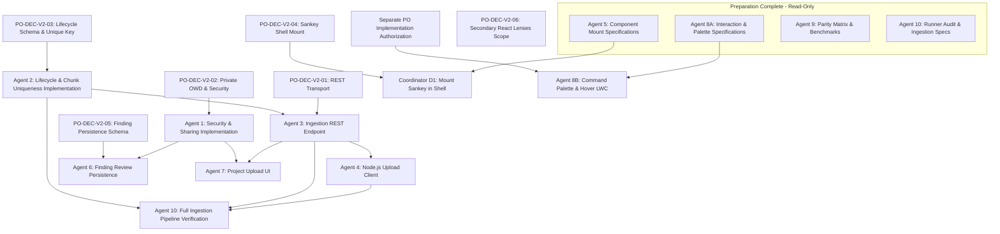

# Phase 1 Preparation Dependency Update

## Document Metadata
- **Classification**: Phase 1 Technical Dependency & Blocker Architecture
- **Date**: 2026-11-10
- **Auditor**: Integration Coordinator D1
- **Status**: AUTHORITATIVE DEPENDENCY TRACKING UPDATE

---

## 1. Updated Dependency Chains

Following the completion of the four preparation assignments, the Phase 1 dependency topology has been refined:

---

## 2. Granular Blocker Catalog

1. **PO Decision Blockers (Executive Authority)**:
   - `PO-DEC-V2-01` blocks Agent 3 REST implementation.
   - `PO-DEC-V2-02` blocks Agent 1 Security OWD transition.
   - `PO-DEC-V2-03` blocks Agent 2 Ingestion Lifecycle schema changes.
   - `PO-DEC-V2-04` blocks Coordinator D1 from mounting `daSankeyView` in `daAppShell`.
   - `PO-DEC-V2-05` blocks Agent 6 Finding Status persistence schema and controller updates.
   - `PO-DEC-V2-06` blocks formal closure of React lens parity gap items.

2. **Technical & Environmental Dependencies**:
   - **Wire Size Exceeding 6 MB Cap**: Blocks Agent 4 upload client until client-side pre-flight size checking and dynamic batch splitting are incorporated into the client design.
   - **Live Salesforce Org Absence**: Blocks formal certification of Apex heap and CPU governor safety for 10-chunk batches (retained as `NOT VERIFIED — LIVE SALESFORCE ORG REQUIRED`).
   - **Shared-Shell Invariant Protection**: Coordinator D1 exclusively controls `daAppShell.*`, preventing any feature workstream from creating merge conflicts or violating `SELECTION != NAVIGATION`.
