# Wave 0.1: Complete Shared Architectural Contract & Dependency Graph

> **AUTHORITATIVE RECONCILIATION NOTICE (RECONCILED BY WAVE 0.2):**
> This graph has been updated by Wave 0.2 to reflect the lifting of the Dagre blocker on `W9-1` (pure in-memory simulation) and the staging of `W7-P1` via Contract A minimal history API.
> Refer to `WAVE_0_2_COMPLETE_CONTRACT_TO_TASK_TRACEABILITY.csv` and `WAVE_0_2_FINAL_IMPLEMENTATION_DISPATCH_READINESS.md` for current authoritative status.

**Status:** RECONCILED & AUTHORITATIVE
**Target Platform:** Salesforce LWC & Apex (Spring '25+)
**Coordinator:** Jules Integration Coordinator

---

## 1. Executive Summary

This deliverable rectifies the dependency graph omissions in Wave 0 by explicitly modeling all nine shared architectural contracts (W0-C1 through W0-C9). Wave 0 tasks referenced C6 (Investigation/Pinning), C7 (Snapshot Diff Engine), and C9 (Error & Loading States), but the original Mermaid diagram omitted them.

This specification details:
- Exact contract definitions, authoritative owners, and producing/consuming components.
- Complete Mermaid dependency graph connecting all 20 feature tasks, 1 integration task, and 9 architectural contracts.
- Freeze status and decision criteria.

---

## 2. Complete Architectural Contract Register

| Contract ID | Contract Name | Purpose | Authoritative Owner | Producing Component / Service | Consuming Workstreams & Tasks | Freeze Status |
| :--- | :--- | :--- | :--- | :--- | :--- | :--- |
| **W0-C1** | Canonical Graph Payload Contract | Defines standard node, edge, and metadata schemas | Lead Architect | `daGraphPayloadLoader` / Ingestion Service | Wave 5 (`W5-2`, `W5-3`, `W5-5`), Wave 6 (`W6-1`, `W6-2`, `W6-3`, `W6-4`), Wave 7 (`W7-1`, `W7-2`), Wave 8 (`W8-2`), Wave 9 (`W9-1`) | FROZEN |
| **W0-C2** | Selection ≠ Navigation Invariant Contract | Governs DOM custom events (`nodeselect`, `edgeselect`, `selectionclear`) preserving active view | UX Architect | Analytical Views (`daGraphViewer`, `daMatrixView`, `daFindingsView`, etc.) | Wave 5 (`W5-4`), Wave 8 (`W8-1`), daAppShell | FROZEN |
| **W0-C3** | Canonical Filter & Preset Contract | Defines V2 filter criteria and predicates via `daFilterSchema.js` | Product Owner & Lead Architect | `daPresetManager` / `daFilterSchema.js` | Wave 5 (`W5-4`), Wave 6 (`W6-1`, `W6-2`, `W6-3`, `W6-4`), Shell | FROZEN |
| **W0-C4** | View Registration & Props Contract | Defines approved shell views and standard `@api` component properties | Integration Coordinator | `daAppShell` | Wave 5 (`W5-1`), Wave 6 (`W6-1`..`4`), Wave 7 (`W7-1`..`3`), Wave 8 (`W8-3`), Wave 9 (`W9-2`) | FROZEN |
| **W0-C5** | Analysis Run & Snapshot Contract | Defines Apex snapshot retrieval API (`getAnalysisRuns`) and project scoping | Apex Lead Architect | `DAGraphController.cls` | Wave 7 (`W7-P1`, `W7-3`), Wave 8 (`W8-3`) | REQUIRES DECISION (Schema gaps on `DA_Analysis_Run__c`) |
| **W0-C6** | Investigation & Pinning Contract | Governs entity pinning and sliding inspector drawer state | UX Architect | `daInvestigationDrawer` | Wave 8 (`W8-1`), daAppShell | FROZEN |
| **W0-C7** | Snapshot Diff & Comparison Contract | Defines pure client-side graph delta calculation (`GraphDiffResult`) | Algorithm Architect | `daDiffEngine.js` | Wave 8 (`W8-2`, `W8-3`) | FROZEN |
| **W0-C8** | Refactoring Simulation Contract | Defines isolated in-memory graph mutation and proposal export | Algorithm Architect | `daRefactoringEngine.js` | Wave 9 (`W9-1`, `W9-2`, `W9-3`) | REQUIRES DECISION (Dagre layout dependency strategy) |
| **W0-C9** | Error & Loading State Contract | Mandates uniform spinner, empty state, and stale request guard | UX Architect & Security Lead | All Analytical Views & Loaders | All Workstreams (Wave 5, 6, 7, 8, 9, Shell) | FROZEN |

---

## 3. Complete Mermaid Architectural & Task Dependency Graph

```mermaid
graph TD
    %% Base Architectural Contracts
    subgraph CONTRACTS [Wave 0 Shared Architectural Contracts]
        C1[C1: Canonical Graph Payload]
        C2[C2: Selection != Navigation]
        C3[C3: V2 Canonical Filter Schema]
        C4[C4: View Registration & Standard Props]
        C5[C5: Analysis Run & Snapshot API]
        C6[C6: Investigation & Pinning Contract]
        C7[C7: Snapshot Diff Engine Contract]
        C8[C8: Refactoring Simulation Contract]
        C9[C9: Error & Loading State Contract]
    end

    %% Workstream A: Wave 5 Deep Graph
    subgraph WAVE_5 [Workstream A: Wave 5 Deep Graph Layouts & Interaction]
        W5_1[W5-1: Shell Layout Switcher] --> W5_2[W5-2: Orbit Layout Activation]
        W5_1 --> W5_3[W5-3: Constellation & Sankey Modes]
        W5_4[W5-4: Directional Traversal Focus]
        W5_5[W5-5: Blast Radius & Impact Calculation]
        W5_6[W5-6: Hover Cards & Tooltip Engine]
    end

    %% Workstream B: Wave 6 Analytical Views
    subgraph WAVE_6 [Workstream B: Wave 6 Analytical Views]
        W6_1[W6-1: Radar View daRadarView]
        W6_2[W6-2: Treemap View daTreemapView]
        W6_3[W6-3: Subway View daSubwayView]
        W6_4[W6-4: Hotspots View daHotspotsView]
    end

    %% Workstream C: Wave 7 Diagnostics & History
    subgraph WAVE_7 [Workstream C: Wave 7 Diagnostics & History]
        W7_P1[W7-P1: Apex getAnalysisRuns] --> W7_3[W7-3: Analysis History View]
        W7_1[W7-1: Diagnostics Scorecard daDiagnosticsView]
        W7_2[W7-2: Architecture DNA daArchitectureDnaBarcode]
    end

    %% Workstream D: Wave 8 Investigation & Compare
    subgraph WAVE_8 [Workstream D: Wave 8 Investigation & Compare]
        W8_1[W8-1: Investigation Drawer daInvestigationDrawer]
        W8_2[W8-2: Diff Engine daDiffEngine] --> W8_3[W8-3: Compare View daCompareView]
    end

    %% Workstream E: Wave 9 Refactoring Simulation
    subgraph WAVE_9 [Workstream E: Wave 9 Refactoring Simulation]
        W9_1[W9-1: Refactoring Engine daRefactoringEngine] --> W9_2[W9-2: Simulation View daRefactoringView]
        W9_1 --> W9_3[W9-3: Handoff Export Modal daRefactorHandoffModal]
    end

    %% Contract to Task Dependencies
    C1 --> W5_2
    C1 --> W5_3
    C1 --> W5_5
    C1 --> W6_1
    C1 --> W6_2
    C1 --> W6_3
    C1 --> W6_4
    C1 --> W7_1
    C1 --> W7_2
    C1 --> W8_2
    C1 --> W9_1

    C2 --> W5_4
    C2 --> W8_1

    C3 --> W5_4
    C3 --> W6_1
    C3 --> W6_2
    C3 --> W6_3
    C3 --> W6_4

    C4 --> W5_1
    C4 --> W6_1
    C4 --> W6_2
    C4 --> W6_3
    C4 --> W6_4
    C4 --> W7_1
    C4 --> W7_3
    C4 --> W8_3
    C4 --> W9_2

    C5 --> W7_P1
    W7_P1 -.->|Unblocks Dual Snapshot Loading| W8_3

    C6 --> W8_1
    C7 --> W8_2
    C8 --> W9_1

    C9 --> W5_1
    C9 --> W6_1
    C9 --> W6_2
    C9 --> W6_3
    C9 --> W6_4
    C9 --> W7_1
    C9 --> W7_2
    C9 --> W7_3
    C9 --> W8_1
    C9 --> W8_3
    C9 --> W9_2

    %% Integration Stage
    subgraph INTEGRATION_STAGE [Stage C: Centralized Shell Integration]
        INT_1[INT-1: Unified Application Shell Integration]
    end

    W5_1 -.-> INT_1
    W5_2 -.-> INT_1
    W5_3 -.-> INT_1
    W5_4 -.-> INT_1
    W5_5 -.-> INT_1
    W5_6 -.-> INT_1
    W6_1 -.-> INT_1
    W6_2 -.-> INT_1
    W6_3 -.-> INT_1
    W6_4 -.-> INT_1
    W7_1 -.-> INT_1
    W7_2 -.-> INT_1
    W7_3 -.-> INT_1
    W8_1 -.-> INT_1
    W8_3 -.-> INT_1
    W9_2 -.-> INT_1
```

---

## 4. Launch Readiness Summary by Dependency Class

1. **Immediately Launchable (12 tasks):**
   - Workstream A: `W5-1`, `W5-4`, `W5-5`, `W5-6`
   - Workstream B: `W6-1`, `W6-2`, `W6-3`, `W6-4`
   - Workstream C: `W7-1`, `W7-2`
   - Workstream D: `W8-1`, `W8-2`

2. **Conditionally Blocked Tasks (2 tasks):**
   - `W7-P1` (Apex): Blocked pending schema field provisioning on `DA_Analysis_Run__c`.
   - `W9-1` (Refactoring Engine): Blocked pending resolution of `dagre` layout dependency strategy in LWC.

3. **Implementation Dependent Tasks (6 tasks):**
   - `W5-2` & `W5-3`: Awaits `W5-1` shell switcher integration.
   - `W7-3`: Awaits unblocking and completion of `W7-P1`.
   - `W8-3`: Awaits unblocking and completion of both `W8-2` and `W7-P1`.
   - `W9-2` & `W9-3`: Awaits unblocking and completion of `W9-1`.

4. **Integration Stage Task (1 task):**
   - `INT-1`: Exclusive ownership of Integration Coordinator in Stage C after all component feature lanes pass offline tests.
