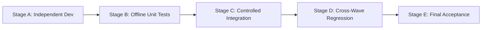

# Wave 0: Integration and Merge Strategy

**Status:** APPROVED FOR IMPLEMENTATION LAUNCH
**Coordinator:** Principal Migration Architect & Integration Coordinator

---

## 1. Multi-Stage Integration Framework

To maintain full parallel velocity across five workstreams without merge collisions, the integration lifecycle is divided into five strictly ordered stages.

---

## 2. Detailed Integration Stages

### Stage A — Independent Concurrent Development
- **Execution Rules:**
  - Feature workstreams develop strictly within their assigned, exclusive directories (`scratch/salesforce-poc/force-app/main/default/lwc/da<FeatureName>/`).
  - Feature lanes **must not** modify shared files: `daAppShell.*`, `daFilterSchema.js`, `daGraphPayloadLoader.js`, or `run-wave4-integration-suite.cjs`.
  - Workstream C exclusively executes `Task W7-P1` on `DAGraphController.cls` and `DAGraphControllerTest.cls`.
- **Environment & Branching Strategy:**
  - In the single-sandbox execution environment, logical lane separation is enforced by exclusive directory ownership.
  - Workstreams operate on dedicated feature branches or isolated task commits if multi-branching is enabled, or develop sequential commits adhering strictly to the file ownership matrix.

### Stage B — Independent Validation & Evidence Production
- **Entry Conditions:** Feature development complete; code compiles cleanly under LWC ES module syntax.
- **Requirements:**
  - Each workstream must produce an offline CommonJS unit test runner in `scratch/salesforce-poc/tests/` (e.g., `run-wave6-analytical-views-tests.cjs`).
  - 100% of newly written tests must pass offline without Salesforce org connectivity.
  - No existing baseline tests (`run-poc-tests.cjs`, `run-wave4-integration-suite.cjs`) may fail.
- **Exit Conditions:** Reproducible test run evidence logged in Markdown.

### Stage C — Controlled Centralized Shell Integration
- **Sole Integration Owner:** Integration Coordinator.
- **Entry Conditions:** Workstream tests pass in Stage B; interface contracts verified against `WAVE_0_SHARED_ARCHITECTURAL_CONTRACTS.md`.
- **Coordinator Actions:**
  1. Add child component references and tab definitions into `daAppShell.html`.
  2. Register component state bindings, getters, and event listeners in `daAppShell.js`.
  3. Wire selection events (`nodeselect`, `edgeselect`) without mutating navigation state (`SELECTION ≠ NAVIGATION`).
  4. Ensure graceful fallback if a child view encounters an error.

### Stage D — Cross-Wave Regression Verification
- **Test Runner:** `scratch/salesforce-poc/tests/run-wave4-integration-suite.cjs` expanded with cross-wave test scenarios.
- **Verification Gates:**
  1. Baseline test suite (187 tests) maintains 100% pass rate.
  2. Rapid project switching discards stale asynchronous payload and preference responses.
  3. Manual node positions (`Positions_JSON__c`) and viewport zoom/pan (`Zoom_Pan_JSON__c`) remain intact across layout switching.
  4. User preferences and presets remain isolated by project.
  5. In-flight Cytoscape instances cleanly destroyed on view switch or component disconnect.

### Stage E — Final Acceptance & Governance Closure
- **Deliverables:** Consolidated parity report, code review sign-off, security audit confirmation.
- **Exit Conditions:** All acceptance criteria met; zero unresolved blockers.

---

## 3. Rollback & Failure Isolation Strategy

If an independently developed component fails in Stage B or C:
1. **Isolated Quarantining:** Because components reside in independent LWC folders, a failing component is decoupled from `daAppShell.html` by commenting out its tab registration.
2. **Zero Blast Radius:** Unmounting a failing view does not affect `daGraphViewer`, `daMatrixView`, `daFindingsView`, or other functional views.
3. **No Rollback of Working Lanes:** A failure in Wave 6 does not block or revert progress in Wave 5 or Wave 7.
