# Wave 0: Parallel Dependency Graph & Execution Matrix

**Status:** APPROVED FOR CONCURRENT DISPATCH
**Coordinator:** Technical Program Coordinator

---

## 1. Executive Dependency Architecture

The execution plan maximizes parallelism by strictly decoupling:
1. **Independent Development:** Components developed in new directories against frozen contracts.
2. **Implementation Dependencies:** Tasks that require previous task deliverables within the same lane.
3. **Prerequisite Unblocking:** Task `W7-P1` (Apex `getAnalysisRuns`) unblocks `W7-3` (History View) and `W8-3` (Compare View).
4. **Integration Gate:** Final mount into `daAppShell` managed exclusively by the Integration Coordinator in Stage C.

---

## 2. Mermaid Parallel Execution Graph

```mermaid
graph TD
    %% Base Contracts
    subgraph WAVE_0_CONTRACTS [Wave 0 Frozen Contracts]
        C1[Canonical Graph Payload W0-C1]
        C2[Selection != Navigation W0-C2]
        C3[V2 Filter Schema W0-C3]
        C4[View Registration W0-C4]
        C5[Analysis Run & Snapshot W0-C5]
        C8[Refactoring Simulation W0-C8]
    end

    %% Workstream A: Wave 5
    subgraph WAVE_5 [Workstream A: Wave 5 Deep Graph]
        W5_1[W5-1: Shell Layout Switcher] --> W5_2[W5-2: Orbit Layout Activation]
        W5_1 --> W5_3[W5-3: Constellation & Sankey]
        W5_4[W5-4: Directional Traversal Focus]
        W5_5[W5-5: Blast Radius & Impact]
        W5_6[W5-6: Hover Cards]
    end

    %% Workstream B: Wave 6
    subgraph WAVE_6 [Workstream B: Wave 6 Analytical Views]
        W6_1[W6-1: Radar View daRadarView]
        W6_2[W6-2: Treemap View daTreemapView]
        W6_3[W6-3: Subway View daSubwayView]
        W6_4[W6-4: Hotspots View daHotspotsView]
    end

    %% Workstream C: Wave 7
    subgraph WAVE_7 [Workstream C: Wave 7 Diagnostics & History]
        W7_P1[W7-P1: Apex getAnalysisRuns] --> W7_3[W7-3: Analysis History View]
        W7_1[W7-1: Diagnostics Scorecard]
        W7_2[W7-2: Architecture DNA Barcode]
    end

    %% Workstream D: Wave 8
    subgraph WAVE_8 [Workstream D: Wave 8 Investigation & Compare]
        W8_1[W8-1: Investigation Drawer]
        W8_2[W8-2: Diff Engine daDiffEngine] --> W8_3[W8-3: Compare View daCompareView]
    end

    %% Workstream E: Wave 9
    subgraph WAVE_9 [Workstream E: Wave 9 Refactoring Simulation]
        W9_1[W9-1: Refactoring Engine] --> W9_2[W9-2: Simulation View]
        W9_1 --> W9_3[W9-3: Handoff Export Modal]
    end

    %% Dependencies from Base Contracts
    C1 --> W5_2
    C1 --> W5_3
    C1 --> W6_1
    C1 --> W6_2
    C1 --> W6_3
    C1 --> W6_4
    C1 --> W7_1
    C1 --> W7_2
    C1 --> W8_2
    C1 --> W9_1

    C2 --> W5_4
    C2 --> W8_1

    C3 --> W6_1
    C3 --> W6_2
    C3 --> W6_3
    C3 --> W6_4

    C5 --> W7_P1
    W7_P1 -.->|Unblocks Dual-Run Payload Fetch| W8_3

    C8 --> W9_1

    %% Integration Stage
    subgraph STAGE_C_INTEGRATION [Stage C: Centralized Shell Integration]
        SHELL_MOUNT[daAppShell Integration by Coordinator]
    end

    W5_1 -.-> SHELL_MOUNT
    W6_1 -.-> SHELL_MOUNT
    W6_2 -.-> SHELL_MOUNT
    W6_3 -.-> SHELL_MOUNT
    W6_4 -.-> SHELL_MOUNT
    W7_1 -.-> SHELL_MOUNT
    W7_3 -.-> SHELL_MOUNT
    W8_1 -.-> SHELL_MOUNT
    W8_3 -.-> SHELL_MOUNT
    W9_2 -.-> SHELL_MOUNT
```

---

## 3. Complete Task-Level Dependency Table

| Task ID | Workstream | Classification | Direct Prerequisites | Unblocks | Start Readiness |
| :--- | :--- | :--- | :--- | :--- | :--- |
| **W5-1** | Wave 5 | CONTRACT_DEPENDENT | Contract W0-C4 | W5-2, W5-3 | Immediate after Wave 0 |
| **W5-2** | Wave 5 | IMPLEMENTATION_DEPENDENT | W5-1, Contract W0-C1 | Full Graph Orbit Mode | Starts after W5-1 |
| **W5-3** | Wave 5 | IMPLEMENTATION_DEPENDENT | W5-1, Contract W0-C1 | Constellation/Sankey Modes | Starts after W5-1 |
| **W5-4** | Wave 5 | CONTRACT_DEPENDENT | Contract W0-C2 | Traversal Toolbar | Immediate after Wave 0 |
| **W5-5** | Wave 5 | CONTRACT_DEPENDENT | Contract W0-C1 | Impact Analysis | Immediate after Wave 0 |
| **W5-6** | Wave 5 | INDEPENDENT | None (DOM/CSS) | Cytoscape Hover Tooltips | Immediate after Wave 0 |
| **W6-1** | Wave 6 | CONTRACT_DEPENDENT | Contracts W0-C1, W0-C3 | `daRadarView` Component | Immediate after Wave 0 |
| **W6-2** | Wave 6 | CONTRACT_DEPENDENT | Contracts W0-C1, W0-C3 | `daTreemapView` Component | Immediate after Wave 0 |
| **W6-3** | Wave 6 | CONTRACT_DEPENDENT | Contracts W0-C1, W0-C3 | `daSubwayView` Component | Immediate after Wave 0 |
| **W6-4** | Wave 6 | CONTRACT_DEPENDENT | Contracts W0-C1, W0-C3 | `daHotspotsView` Component | Immediate after Wave 0 |
| **W7-P1**| Wave 7 | CONTRACT_DEPENDENT | Contract W0-C5 | W7-3, W8-3 | Immediate after Wave 0 (Highest Apex Priority) |
| **W7-1** | Wave 7 | CONTRACT_DEPENDENT | Contract W0-C1 | `daDiagnosticsView` | Immediate after Wave 0 |
| **W7-2** | Wave 7 | CONTRACT_DEPENDENT | Contract W0-C1 | `daArchitectureDnaBarcode` | Immediate after Wave 0 |
| **W7-3** | Wave 7 | IMPLEMENTATION_DEPENDENT | Task W7-P1 | Historical Run Selection | Blocked until W7-P1 passes unit tests |
| **W8-1** | Wave 8 | CONTRACT_DEPENDENT | Contract W0-C2, W0-C6 | `daInvestigationDrawer` | Immediate after Wave 0 |
| **W8-2** | Wave 8 | CONTRACT_DEPENDENT | Contract W0-C7 | `daDiffEngine.js` | Immediate after Wave 0 |
| **W8-3** | Wave 8 | IMPLEMENTATION_DEPENDENT | Task W8-2, Task W7-P1 | `daCompareView` | Starts after W8-2 & W7-P1 |
| **W9-1** | Wave 9 | CONTRACT_DEPENDENT | Contract W0-C8 | `daRefactoringEngine.js` | Immediate after Wave 0 |
| **W9-2** | Wave 9 | IMPLEMENTATION_DEPENDENT | Task W9-1 | `daRefactoringView` | Starts after W9-1 |
| **W9-3** | Wave 9 | IMPLEMENTATION_DEPENDENT | Task W9-1 | `daRefactorHandoffModal` | Starts after W9-1 |
| **INT-1**| Shell | INTEGRATION_DEPENDENT | W5, W6, W7, W8, W9 | Unified Application Shell | Stage C (Coordinator Only) |

---

## 4. Parallel Launch Concurrency Summary

- **Immediately Launchable Tasks (Day 1):**
  - **Workstream A:** W5-1, W5-4, W5-5, W5-6
  - **Workstream B:** W6-1, W6-2, W6-3, W6-4 (100% of Wave 6 can develop concurrently)
  - **Workstream C:** W7-P1 (Apex controller), W7-1, W7-2
  - **Workstream D:** W8-1, W8-2
  - **Workstream E:** W9-1
- **Dependent Tasks:**
  - `W7-3` and `W8-3` await `W7-P1` completion and test verification.
  - `W9-2` and `W9-3` await `W9-1` calculation engine verification.
  - All shell mounts await Stage C coordinator integration.
