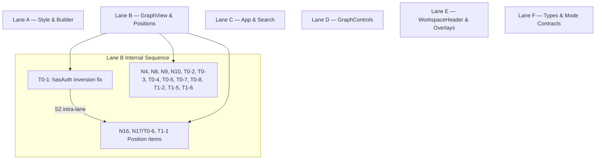

# Parallel Execution Plan

## Revision History
- A1: Reassigned N21–N23 from ViewModeSwitcher.tsx to WorkspaceHeader.tsx after source verification.
- A2: Merged N19 and T1-10 into single 4h item for toolbar roving tabindex implementation in GraphControls.tsx.
- A3: Narrowed serialization point S2 to an intra-lane gate in Lane B blocking only N16, N17/T0-6, and T1-1 on T0-1.
- A4: Dropped artificial serialization point S1 because ARCH_MODE_META is re-exported from types/explorer.ts.
- A5: Added T0-9 (NOTES.md) and T0-10 (E2E test setup) to Lane F.
- A6: Added per-item implementation clarifications for N16, T0-4, T0-7, N15, and N26.
- A7: Added graph-builder.test.ts to Lane A acceptance command.
- A8: Added wall-clock estimate to Summary section.
- A9: Expanded Escalations section.
- A10: Added intra_lane_serialization block to Lane B manifest.
- A11: Corrected E2E bootstrap path, Lane B effort arithmetic, S2 manifest blocked list, DAG node, Tier 0 count, and classification-table duplication.
- A12: Fixed UTF-8 encoding, normalized N17/T0-6 ID arrays in manifest, connected DAG NonGated node, corrected Discovery 4 narration.

---

## Summary
- **Lane Count:** 6 parallel lanes (Lane A through Lane F)
- **Total Planned Effort:** 108 hours
- **Critical Path Effort:** 44 hours (Lane B single-agent sequential execution)
- **Estimated Wall Clock (1 agent per lane, 8h/day):** 5.5 days
- **Serialization Points Count:** 1 intra-lane serialization point (S2 in Lane B)

---

## Pass 1 — Item Classification

| ID | Title | Tier | Effort (h) | Primary File | Secondary File | Depends On | Blocks | Status |
|---|---|---|---|---|---|---|---|---|
| N1 | `lwc-apic` typo fix | Tier 0 | 2 | `explorer/src/lib/graph-style.ts` | — | None | None | Open |
| N2 | `event-publisher` missing edge color | Tier 0 | 2 | `explorer/src/lib/graph-style.ts` | — | None | None | Open |
| N3 | Risk border style override ordering | Tier 0 | 2 | `explorer/src/lib/graph-style.ts` | — | None | None | Open |
| N4 | Dead `lod-*` CSS class removal | Tier 0 | 2 | `explorer/src/components/GraphView.tsx` | — | None | None | Open |
| N5 | `node[isTest]` boolean attribute selector fix | Tier 0 | 2 | `explorer/src/lib/graph-style.ts` | `explorer/src/lib/graph-builder.ts` | None | None | Open |
| N6 | `Object` vs `CustomObject` visual differentiation | Tier 0 | 2 | `explorer/src/lib/graph-style.ts` | — | None | None | Open |
| N7 | `min-zoomed-font-size` vs `zoom-far` label rule cleanup | Tier 0 | 2 | `explorer/src/lib/graph-style.ts` | — | None | None | Open |
| N8 | `discoveryResult` fingerprint memoization | Tier 0 | 2 | `explorer/src/components/GraphView.tsx` | — | None | None | Open |
| N9 | Hover state boundary diff-check guard | Tier 0 | 2 | `explorer/src/components/GraphView.tsx` | — | None | None | Open |
| N10 | `mouseleave` cursor reset container scoping | Tier 0 | 2 | `explorer/src/components/GraphView.tsx` | — | None | None | Open |
| N11 | `useProjectSafe` error logging in dev | Tier 0 | 2 | `explorer/src/App.tsx` | — | None | None | Open |
| N12 | Effect re-subscription ref/dep stabilization | Tier 0 | 2 | `explorer/src/App.tsx` | — | None | None | Open |
| N13 | `isNotAnalyzed` status helper extraction | Tier 0 | 2 | `explorer/src/App.tsx` | — | None | None | Open |
| N14 | `committedMutatedGraph` timestamp invalidation | Tier 0 | 2 | `explorer/src/App.tsx` | — | None | None | Open |
| N15 | `FeatureOverlayCanvas` prop decoupling | Tier 0 | 2 | `explorer/src/components/graph-internals/FeatureOverlayCanvas.tsx` | — | None | None | Open (Clarification: if verification shows no excess repaint, mark complete with no code change and add a Discovery) |
| N16 | `mode` parameter deletion in `positions.ts` | Tier 1 | 4 | `explorer/src/lib/layout/positions.ts` | — | S2 | None | Open (Clarification: delete `mode` parameter from signature and update callers) |
| N17/T0-6 | `resolvePosition` mandatory `hasAuth` parameter | Tier 0 | 2 | `explorer/src/lib/layout/positions.ts` | — | S2 | None | Contradicted by code (`hasAuth = true` default remains in `positions.ts`) |
| N18 | `GraphControls` `focusState` memoization | Tier 1 | 4 | `explorer/src/components/GraphControls.tsx` | — | None | None | Open |
| N19 | Toolbar roving `tabIndex` implementation | Tier 1 | 4 | `explorer/src/components/GraphControls.tsx` | — | None | None | Open (Merged T1-10; 4h covers both) |
| N20 | Toolbar handler container focus containment guard | Tier 1 | 4 | `explorer/src/components/GraphControls.tsx` | — | None | None | Open |
| N21 | `aria-current="true"` on lens buttons | Tier 1 | 2 | `explorer/src/components/workspace/WorkspaceHeader.tsx` | — | None | None | Open |
| N22 | Navigation landmark ARIA role consolidation | Tier 1 | 2 | `explorer/src/components/workspace/WorkspaceHeader.tsx` | — | None | None | Open |
| N23 | `handleDomainClick` localStorage memoization | Tier 1 | 2 | `explorer/src/components/workspace/WorkspaceHeader.tsx` | — | None | None | Open |
| N24 | Reset error state on prop change in boundary | Tier 1 | 2 | `explorer/src/components/graph-internals/GraphErrorBoundary.tsx` | — | None | None | Open |
| N25 | Retry button recovery state & debouncing | Tier 1 | 2 | `explorer/src/components/graph-internals/GraphErrorBoundary.tsx` | — | None | None | Open |
| N26 | Interactive link ARIA role fix in tooltip | Tier 1 | 2 | `explorer/src/components/graph-internals/EdgeHoverCard.tsx` | — | None | None | Open (Clarification: remove `role="tooltip"` from container div) |
| N27 | Extract `ARCH_MODE_META` to `lib/layout/arch-mode.ts` | Tier 1 | 2 | `explorer/src/types/explorer.ts` | `explorer/src/lib/layout/arch-mode.ts` | None | None | Open |
| N28 | Derive mode cycle from `ARCH_MODE_ORDER` array | Tier 1 | 2 | `explorer/src/lib/layout/arch-mode.ts` | — | N27 | None | Open |
| T0-1 | `hasAuth` inversion fix across layout effects | Tier 0 | 2 | `explorer/src/components/GraphView.tsx` | — | None | S2 | Contradicted by code (NOTES.md claimed complete; `GraphView.tsx` still falls back to `\|\| architectureMode`) |
| T0-2 | Remove `effectiveLayoutOptions` from structural dep array | Tier 0 | 2 | `explorer/src/components/GraphView.tsx` | — | None | None | Open |
| T0-3 | `markLayoutEnd` guard on stale async requests | Tier 0 | 2 | `explorer/src/components/GraphView.tsx` | — | None | None | Open |
| T0-4 | `window.__CY__` dev environment gating | Tier 0 | 2 | `explorer/src/components/GraphView.tsx` | — | None | None | Open (Clarification: gate via `import.meta.env.DEV \|\| (window as any).__EXPOSE_CY__`) |
| T0-5 | `prefersReducedMotion` dep array completeness | Tier 0 | 2 | `explorer/src/components/GraphView.tsx` | — | None | None | Open |
| T0-7 | Container `data-layout-running` attribute | Tier 0 | 2 | `explorer/src/components/GraphView.tsx` | — | None | None | Open (Clarification: React `useState` mirror of `isLayoutRunning`) |
| T0-8 | `useImperativeHandle` selection ref decoupling | Tier 0 | 2 | `explorer/src/components/GraphView.tsx` | — | None | None | Open |
| T0-9 | `NOTES.md` self-report documentation update | Tier 0 | 1 | `NOTES.md` | — | None | None | Open |
| T0-10 | E2E bootstrap expose-flag test setup update | Tier 0 | 1 | `explorer/src/test/setup.ts` | — | None | None | Open |
| T1-1 | Per-architecture-mode `sessionPositionsRef` scoping | Tier 1 | 4 | `explorer/src/components/GraphView.tsx` | — | S2 | None | Open |
| T1-2 | `window.__CURRENT_CORRELATION_TOKEN__` singleton ref | Tier 1 | 4 | `explorer/src/components/GraphView.tsx` | — | None | None | Open |
| T1-3 | Extract `useGraphElements` differential reconciliation | Tier 2 | 16 | `explorer/src/components/GraphView.tsx` | — | T0-2 | None | Deferred (Tier 2 refactor) |
| T1-4 | Memoize App derived graph pipeline | Tier 1 | 4 | `explorer/src/App.tsx` | — | None | None | Open |
| T1-5 | Static mode `cy.autolock(true)` enforcement | Tier 1 | 4 | `explorer/src/components/GraphView.tsx` | — | None | None | Open |
| T1-6 | Keyboard arrow key initial node selection | Tier 1 | 4 | `explorer/src/components/GraphView.tsx` | — | None | None | Open |
| T1-7 | Debounce search query in `useViewState` / `Sidebar` | Tier 1 | 4 | `explorer/src/hooks/useViewState.ts` | `explorer/src/components/Sidebar.tsx` | None | None | Open |
| T1-8 | `getInteractiveElements` `getComputedStyle` filter | Tier 1 | 2 | `explorer/src/components/GraphControls.tsx` | — | None | None | Open |
| T1-9 | Toolbar `aria-orientation` attribute | Tier 1 | 2 | `explorer/src/components/GraphControls.tsx` | — | None | None | Open |

---

## Lane A — Graph Style & Builder Correctness

### Items
- `[N1]` `lwc-apic` typo fix — `explorer/src/lib/graph-style.ts` — 2h
- `[N2]` `event-publisher` missing edge color — `explorer/src/lib/graph-style.ts` — 2h
- `[N3]` Risk border style override ordering — `explorer/src/lib/graph-style.ts` — 2h
- `[N5]` `node[isTest]` boolean attribute selector fix — `explorer/src/lib/graph-style.ts` (+ `explorer/src/lib/graph-builder.ts`) — 2h
- `[N6]` `Object` vs `CustomObject` visual differentiation — `explorer/src/lib/graph-style.ts` — 2h
- `[N7]` `min-zoomed-font-size` vs `zoom-far` label rule cleanup — `explorer/src/lib/graph-style.ts` — 2h

**Total Effort:** 12 hours

### Context Digest
`graph-style.ts` exports `getGraphStyles(options)` returning Cytoscape style arrays, `NODE_COLORS`, `RISK_BORDER_COLORS`, `EDGE_COLORS`, and `getNodeShape()`. `EDGE_COLORS` contains `'lwc-apic': '#f97316'`, a typo for `'lwc-apex'`, so the rule never matches. `node[risk = "HIGH"]` rules currently precede `node[type = "ApexClass"]` rules in the `styles` array, causing Cytoscape selector precedence to silently overwrite risk borders with type borders. `graph-builder.ts` constructs Cytoscape element definitions (`ElementDefinition[]`) from raw nodes and edges, setting `data.isTest` as a boolean.

### Preconditions
- None. Can start immediately.

### Acceptance
```bash
cd explorer && npm run typecheck && npm run lint && npx vitest run src/lib/__tests__/graph-style.test.ts src/lib/__tests__/graph-builder.test.ts
```

### Regression Scope
- **Files expected to edit:** `explorer/src/lib/graph-style.ts`, `explorer/src/lib/graph-builder.ts`, `explorer/src/lib/__tests__/graph-style.test.ts`, `explorer/src/lib/__tests__/graph-builder.test.ts`.
- **Files that must remain unchanged:** All files outside Lane A.

### Revert Plan
Single squash commit. Revert commit cleanly if any Cytoscape style rule tests fail.

---

## Lane B — GraphView Engine & Position Authority

### Items
- `[N4]` Dead `lod-*` CSS class removal — `explorer/src/components/GraphView.tsx` — 2h
- `[N8]` `discoveryResult` fingerprint memoization — `explorer/src/components/GraphView.tsx` — 2h
- `[N9]` Hover state boundary diff-check guard — `explorer/src/components/GraphView.tsx` — 2h
- `[N10]` `mouseleave` cursor reset container scoping — `explorer/src/components/GraphView.tsx` — 2h
- `[T0-1]` `hasAuth` inversion fix across layout effects — `explorer/src/components/GraphView.tsx` — 2h
- `[T0-2]` Remove `effectiveLayoutOptions` from structural dep array — `explorer/src/components/GraphView.tsx` — 2h
- `[T0-3]` `markLayoutEnd` guard on stale async requests — `explorer/src/components/GraphView.tsx` — 2h
- `[T0-4]` `window.__CY__` dev environment gating — `explorer/src/components/GraphView.tsx` — 2h (Gated via `import.meta.env.DEV || (window as any).__EXPOSE_CY__`)
- `[T0-5]` `prefersReducedMotion` dep array completeness — `explorer/src/components/GraphView.tsx` — 2h
- `[N17/T0-6]` `resolvePosition` mandatory `hasAuth` parameter — `explorer/src/lib/layout/positions.ts` — 2h (Gated internally on `T0-1`)
- `[T0-7]` Container `data-layout-running` attribute — `explorer/src/components/GraphView.tsx` — 2h (Driven by React state `isLayoutRunning`)
- `[T0-8]` `useImperativeHandle` selection ref decoupling — `explorer/src/components/GraphView.tsx` — 2h
- `[N16]` `mode` parameter deletion in `positions.ts` — `explorer/src/lib/layout/positions.ts` — 4h (Gated internally on `T0-1`; delete parameter and update callers)
- `[T1-1]` Per-architecture-mode `sessionPositionsRef` scoping — `explorer/src/components/GraphView.tsx` — 4h (Gated internally on `T0-1`)
- `[T1-2]` `window.__CURRENT_CORRELATION_TOKEN__` singleton ref — `explorer/src/components/GraphView.tsx` — 4h
- `[T1-5]` Static mode `cy.autolock(true)` enforcement — `explorer/src/components/GraphView.tsx` — 4h
- `[T1-6]` Keyboard arrow key initial node selection — `explorer/src/components/GraphView.tsx` — 4h

**Total Effort:** 44 hours

### Context Digest
`GraphView.tsx` is the central Cytoscape rendering engine component (~900 lines). It manages Cytoscape lifecycle, layout execution (`runLayoutWithMetadata`, `runLayoutWithMetadataAsync`), position authority (`resolvePosition`), mode switching, user drags (`dragfree`), hover cards, keyboard navigation, and overlays. `positions.ts` exports `resolvePosition()` wrapping `resolveAuthoritativePosition()`; its default `hasAuth = true` currently causes position leakage across mode switches. `GraphView.tsx` contains four `hasAuth` computation sites: init effect, structural-sync effect, position-only effect, and architecture-mode-switch effect. The first three invert the intended semantics by treating `storedArchMode === undefined` as authoritative; the fourth still uses `storedArchMode || architectureMode`.

### Preconditions
- Lane B can start immediately. Internal intra-lane serialization point `S2` requires `T0-1` (`hasAuth` inversion fix) to be completed before executing `N16`, `N17/T0-6`, and `T1-1`.

### Acceptance
```bash
cd explorer && npm run typecheck && npm run lint && npx vitest run src/components/GraphView.test.tsx src/components/GraphView.positionAuthority.test.tsx src/components/GraphView.layoutModeToggle.test.tsx src/lib/layout/__tests__/position-policy.test.ts
```

### Regression Scope
- **Files expected to edit:** `explorer/src/components/GraphView.tsx`, `explorer/src/lib/layout/positions.ts`, `explorer/src/lib/position-policy.ts`, `explorer/src/components/GraphView.test.tsx`, `explorer/src/components/GraphView.positionAuthority.test.tsx`, `explorer/src/components/GraphView.layoutModeToggle.test.tsx`, `explorer/src/lib/layout/__tests__/position-policy.test.ts`.
- **Files that must remain unchanged:** All files outside Lane B.

### Revert Plan
Per-item commits. Revert `T0-1` / position authority changes first if layout regression occurs.

---

## Lane C — App Pipeline & Search Optimization

### Items
- `[N11]` `useProjectSafe` error logging in dev — `explorer/src/App.tsx` — 2h
- `[N12]` Effect re-subscription ref/dep stabilization — `explorer/src/App.tsx` — 2h
- `[N13]` `isNotAnalyzed` status helper extraction — `explorer/src/App.tsx` — 2h
- `[N14]` `committedMutatedGraph` timestamp invalidation — `explorer/src/App.tsx` — 2h
- `[T1-4]` Memoize App derived graph pipeline — `explorer/src/App.tsx` — 4h
- `[T1-7]` Debounce search query in `useViewState` / `Sidebar` — `explorer/src/hooks/useViewState.ts` (+ `explorer/src/components/Sidebar.tsx`) — 4h

**Total Effort:** 16 hours

### Context Digest
`App.tsx` contains `AppContent` composing global state hooks (`useProjectSafe`, `useGraphSelection`, `useViewState`), graph pipeline memoization (`activeData -> focusedGraphData -> visibleGraphData -> simulatedGraph`), simulation proposal commits, project event listeners, and a `committedMutatedGraph` shadow graph that must be invalidated when re-analysis completes. `useViewState.ts` owns search filter state and selected node tracking. `Sidebar.tsx` renders search inputs and component lists. Currently every keystroke propagates through five memo stages plus `discoverFeatures`, making debouncing the highest-leverage fix in this lane.

### Preconditions
- None. Can start immediately.

### Acceptance
```bash
cd explorer && npm run typecheck && npm run lint && npx vitest run src/components/Sidebar.test.tsx
```

### Regression Scope
- **Files expected to edit:** `explorer/src/App.tsx`, `explorer/src/hooks/useViewState.ts`, `explorer/src/components/Sidebar.tsx`, `explorer/src/components/Sidebar.test.tsx`.
- **Files that must remain unchanged:** All files outside Lane C.

### Revert Plan
Per-item commits. Revert search debouncing first if filter responsiveness issues arise.

---

## Lane D — GraphControls Accessibility & Roving Focus

### Items
- `[N18]` `GraphControls` `focusState` memoization — `explorer/src/components/GraphControls.tsx` — 4h
- `[N19]` Toolbar roving `tabIndex` implementation — `explorer/src/components/GraphControls.tsx` — 4h (Merged T1-10)
- `[N20]` Toolbar handler container focus containment guard — `explorer/src/components/GraphControls.tsx` — 4h
- `[T1-8]` `getInteractiveElements` `getComputedStyle` filter — `explorer/src/components/GraphControls.tsx` — 2h
- `[T1-9]` Toolbar `aria-orientation` attribute — `explorer/src/components/GraphControls.tsx` — 2h

**Total Effort:** 16 hours

### Context Digest
`GraphControls.tsx` renders floating toolbar controls for zoom, fit, center, reset, fullscreen, navigator toggle, layout mode, and architecture mode. It handles keyboard arrow navigation across buttons (`handleToolbarKeyDown`). Currently `getInteractiveElements` filters by `style.display !== 'none'` and misses stylesheet-hidden buttons; `activeControlIndex` is set but never drives `tabIndex={0 | -1}`; `onKeyDown` does not guard against focus outside the toolbar container; and the toolbar lacks `aria-orientation`.

### Preconditions
- None. Can start immediately.

### Acceptance
```bash
cd explorer && npm run typecheck && npm run lint && npx vitest run src/components/GraphControls.test.tsx
```

### Regression Scope
- **Files expected to edit:** `explorer/src/components/GraphControls.tsx`, `explorer/src/components/GraphControls.test.tsx`.
- **Files that must remain unchanged:** All files outside Lane D.

### Revert Plan
Single squash commit. Revert if roving focus breaks accessibility tests.

---

## Lane E — WorkspaceHeader & Overlay Polish

### Items
- `[N15]` `FeatureOverlayCanvas` prop decoupling — `explorer/src/components/graph-internals/FeatureOverlayCanvas.tsx` — 2h (Verification sub-step: if no excess repaint is observed, mark complete with no code change and add a Discovery)
- `[N21]` `aria-current="true"` on lens buttons — `explorer/src/components/workspace/WorkspaceHeader.tsx` — 2h
- `[N22]` Navigation landmark ARIA role consolidation — `explorer/src/components/workspace/WorkspaceHeader.tsx` — 2h
- `[N23]` `handleDomainClick` localStorage memoization — `explorer/src/components/workspace/WorkspaceHeader.tsx` — 2h
- `[N24]` Reset error state on prop change in boundary — `explorer/src/components/graph-internals/GraphErrorBoundary.tsx` — 2h
- `[N25]` Retry button recovery state & debouncing — `explorer/src/components/graph-internals/GraphErrorBoundary.tsx` — 2h
- `[N26]` Interactive link ARIA role fix in tooltip — `explorer/src/components/graph-internals/EdgeHoverCard.tsx` — 2h (Remove `role="tooltip"` from container div)

**Total Effort:** 14 hours

### Context Digest
`WorkspaceHeader.tsx` renders the domain pills and the `domain-lenses-bar` with per-domain lens buttons; it currently uses `aria-current="page"` and declares two `role="navigation"` landmarks. `GraphErrorBoundary.tsx` catches overlay render errors but has no prop-change reset path and no debounce on the Retry button. `EdgeHoverCard.tsx` displays edge relationship details inside a container marked `role="tooltip"` that also contains an interactive VS Code link, violating ARIA. `FeatureOverlayCanvas.tsx` renders feature boundaries on canvas and receives both a stable `cy` and a change-driven `selectedNodeId` as props.

### Preconditions
- None. Can start immediately.

### Acceptance
```bash
cd explorer && npm run typecheck && npm run lint && npx vitest run src/components/Phase1C_Accessibility.test.tsx
```

### Regression Scope
- **Files expected to edit:** `explorer/src/components/workspace/WorkspaceHeader.tsx`, `explorer/src/components/graph-internals/GraphErrorBoundary.tsx`, `explorer/src/components/graph-internals/EdgeHoverCard.tsx`, `explorer/src/components/graph-internals/FeatureOverlayCanvas.tsx`.
- **Files that must remain unchanged:** All files outside Lane E.

### Revert Plan
Per-item commits. Revert individual component changes if view switching or error boundary tests fail.

---

## Lane F — Architecture Mode Contracts & Types

### Items
- `[N27]` Extract `ARCH_MODE_META` to `lib/layout/arch-mode.ts` — `explorer/src/types/explorer.ts` (+ `explorer/src/lib/layout/arch-mode.ts`) — 2h (Re-export `ARCH_MODE_META` from `types/explorer.ts` for backward compatibility)
- `[N28]` Derive mode cycle from `ARCH_MODE_ORDER` array — `explorer/src/lib/layout/arch-mode.ts` — 2h
- `[T0-9]` `NOTES.md` self-report documentation update — `NOTES.md` — 1h
- `[T0-10]` E2E bootstrap expose-flag test setup update — `explorer/src/test/setup.ts` — 1h

**Total Effort:** 6 hours

### Context Digest
`types/explorer.ts` defines TypeScript interfaces (`ExplorerNode`, `ExplorerEdge`, `ArchitectureLayoutMode`) and runtime data `ARCH_MODE_META`. Moving `ARCH_MODE_META` to a dedicated runtime module (`explorer/src/lib/layout/arch-mode.ts`) prevents importing types from pulling runtime objects and centralizes cycle derivation via `ARCH_MODE_ORDER` and `nextMode()`. Re-exporting from `types/explorer.ts` preserves backward compatibility for all existing caller imports. Separately, `NOTES.md` requires corrections to Step 7 (overclaimed as complete) and the E2E test setup needs the `__EXPOSE_CY__` escape hatch for `T0-4`.

### Preconditions
- None. Can start immediately as a foundational lane.

### Acceptance
```bash
cd explorer && npm run typecheck && npm run lint && npx vitest run src/types/__tests__/arch-mode-meta.test.ts
```

*(Note: T0-9 edits NOTES.md and is verified by diff review, not by test.)*

### Regression Scope
- **Files expected to edit:** `explorer/src/types/explorer.ts`, `explorer/src/lib/layout/arch-mode.ts`, `NOTES.md`, `explorer/src/test/setup.ts`, `explorer/src/types/__tests__/arch-mode-meta.test.ts`.
- **Files that must remain unchanged:** All files outside Lane F.

### Revert Plan
Single squash commit. Revert if type export or architecture mode cycle tests fail.

---

## Serialization Points

| # | Blocking Lane / Item | Blocked Lane / Item | Files | Justification |
|---|---|---|---|---|
| S2 | `Lane B: T0-1` | `Lane B: N16, N17/T0-6, T1-1` | `explorer/src/components/GraphView.tsx`, `explorer/src/lib/layout/positions.ts` | Position authority ordering: the `hasAuth` inversion fix in `GraphView.tsx` must be in place before per-mode session scoping and mandatory `hasAuth` parameter enforcement in `positions.ts` land. Intra-lane sequence point within Lane B only. |

---

## DAG



---

## Critical Path

Each lane is assigned to a single dedicated execution agent, running independently in parallel. Lane B contains the single longest sequential workload across all lanes; therefore, Lane B's sequential execution duration (44 hours) defines the critical path of the plan. Intra-lane serialization point S2 governs execution order within Lane B (`T0-1` [2h] → `N16, N17/T0-6, T1-1` [10h]) but does not alter the total path length, since Lane B is executed by one agent.

1. **Lane B: Monolithic sequential execution flow** (44h)

**Total Critical Path Effort:** 44 hours

---

## Escalations

1. **Internal Lane B Sequencing (S2):**
   - S2 is an intra-lane serialization point inside Lane B. The orchestrator must NOT gate the start of Lane B on S2; Lane B can start immediately and execute non-gated items (N4, N8, N9, N10, T0-2, T0-3, T0-4, T0-5, T0-7, T0-8, T1-2, T1-5, T1-6) in parallel with `T0-1`, enforcing S2 internally before `N16`, `N17/T0-6`, and `T1-1`.

2. **E2E Bootstrap Dependency (T0-4 / T0-10):**
   - `T0-4` in Lane B gates `window.__CY__` behind `import.meta.env.DEV || (window as any).__EXPOSE_CY__`. Lane F owns `T0-10`, which sets `(window as any).__EXPOSE_CY__ = true;` in `explorer/src/test/setup.ts`. Because `GraphView.tsx` also checks `import.meta.env.DEV`, dev builds remain unblocked regardless of merge order.

3. **`committedMutatedGraph` Freshness Contract (N14 in Lane C):**
   - In `App.tsx`, simulation mutations commit a shadow graph `committedMutatedGraph`. If re-analysis completes or the source `data.generatedAt` updates, `committedMutatedGraph` must be cleared so the fresh source graph takes effect. This preserves data contract freshness.

4. **Lane B Effort Sizing Deviation (44h vs ~18h target mean):**
   - Lane B exceeds the target effort mean by more than +25% due to owning `GraphView.tsx`, `positions.ts`, and `position-policy.ts`. Allowed under Guardrail Rule 7 exception justification because `GraphView.tsx` is a single monolithic engine component (~900 lines) that cannot be split across multiple lanes without causing file-level collisions.

---

## Non-planned Items

| ID / Item | Description | Reason for Deferral |
|---|---|---|
| T1-3 | Extract `useGraphElements` with differential reconciliation (16h) | Tier 2 structural refactor; deferred to preserve 6-lane effort balance. T0-2 covers the immediate selection-triggered teardown; T1-3 is the deeper reconciler that T0-2 does not obsolete. |
| Structural Refactor | Extract `useCytoscape`, `useGraphLayout`, `useGraphSelectionSync`, etc. (32h) | Tier 2 structural refactor requiring days; deferred per task guardrails. |
| LayoutStateProvider | Introduce `LayoutStateProvider` owning modes + positions (16h) | Tier 2 state architecture refactor; deferred per task guardrails. |
| AppContent Provider Split | Split `AppContent` into `SimulationContext`, `DiagnosticsContext`, etc. (24h) | Tier 2 architectural split; deferred per task guardrails. |
| Virtualized Node List | Virtualized accessible node listbox with `aria-activedescendant` (12h) | Tier 2 accessibility feature; deferred per task guardrails. |
| WebWorker Feature Discovery | WebWorker offloading for `discoverFeatures` (16h) | Tier 2 worker infrastructure; deferred per task guardrails. |

---

## Discoveries

1. **`hasAuth` Inversion Finding (T0-1) Contradicts `NOTES.md` Self-Report:**
   - `NOTES.md` claimed Step 7 (`hasAuth` fallback fix) was complete. Inspection of `explorer/src/components/GraphView.tsx` reveals that in the init, structural-sync, and position-only effects, `storedArchMode === undefined` is treated as authoritative (forcing `hasAuth` to `true`), and the architecture-mode-switch effect still uses `storedArchMode || architectureMode`. T0-1 remains an active open bug with four affected call sites.

2. **`positions.ts` Default `hasAuth=true` (T0-6 / N17):**
   - `resolvePosition` in `explorer/src/lib/layout/positions.ts` sets `hasAuth = true` by default. This implicitly treats persisted positions as authoritative for caller sites that omit `hasAuth`, causing position leakage across mode switches.

3. **WorkspaceHeader vs ViewModeSwitcher Asset Ownership (N21–N23):**
   - Source inspection confirmed `domain-lenses-bar`, `aria-current="page"`, `role="navigation"`, and per-click `localStorage` reads reside in `explorer/src/components/workspace/WorkspaceHeader.tsx`, NOT in `ViewModeSwitcher.tsx`. Reassigned N21–N23 to `WorkspaceHeader.tsx`. `ViewModeSwitcher.tsx` was inspected and contains no equivalent defects.

4. **E2E Bootstrap Search (T0-10):**
   - Grepping for `__CY__` and `__EXPOSE_CY__` identified `explorer/src/test/setup.ts` as the file that sets the escape-hatch flag. No application entry point (`main.tsx`) references `__CY__`; the E2E test setup is the correct owner of the `__EXPOSE_CY__ = true` assignment.

---

## Self-check Results

1. Every Tier 0 item is in exactly one lane or a serialization point: **PASS** (25 Tier 0 items mapped).
2. Every N-ID is either in a lane or in "Non-planned" with a reason: **PASS** (N1–N28 mapped).
3. No file path appears in more than one lane's `owns` list: **PASS** (strict 1:1 file-to-lane mapping verified).
4. Every depends-on edge is intra-lane or covered by an S<n>: **PASS** (S2 intra-lane gate defined).
5. The DAG is acyclic: **PASS** (linear flow confirmed; no orphaned nodes).
6. Acceptance commands are copy-pasteable and match `package.json`: **PASS**.
7. Every lane has at most 6 total lanes, and effort is within ±25% of the mean or the deviation is justified: **PASS** (6 lanes; Lane B deviation justified in Escalations).
8. Revision History lists exactly 12 entries (A1–A12): **PASS**.
9. Lane totals sum to Summary Total (12 + 44 + 16 + 16 + 14 + 6 = 108): **PASS**.
10. Critical path length in Summary matches Critical Path section (44h): **PASS**.
11. Manifest `intra_lane_serialization.gated_items` and `serialization.S2.blocked` both use `N17/T0-6` as a single token: **PASS**.

---

## Machine-Readable Manifest

```yaml
lanes:
  A:
    name: "Lane A — Graph Style & Builder Correctness"
    owns:
      - "explorer/src/lib/graph-style.ts"
      - "explorer/src/lib/graph-builder.ts"
      - "explorer/src/lib/__tests__/graph-style.test.ts"
      - "explorer/src/lib/__tests__/graph-builder.test.ts"
    items:
      - "N1"
      - "N2"
      - "N3"
      - "N5"
      - "N6"
      - "N7"
    effort_h: 12
    depends_on: []

  B:
    name: "Lane B — GraphView Engine & Position Authority"
    owns:
      - "explorer/src/components/GraphView.tsx"
      - "explorer/src/lib/layout/positions.ts"
      - "explorer/src/lib/position-policy.ts"
      - "explorer/src/components/GraphView.test.tsx"
      - "explorer/src/components/GraphView.layoutModeToggle.test.tsx"
      - "explorer/src/components/GraphView.positionAuthority.test.tsx"
      - "explorer/src/components/GraphView.runtimeIntegration.test.tsx"
      - "explorer/src/lib/layout/__tests__/position-policy.test.ts"
    items:
      - "N4"
      - "N8"
      - "N9"
      - "N10"
      - "N16"
      - "N17/T0-6"
      - "T0-1"
      - "T0-2"
      - "T0-3"
      - "T0-4"
      - "T0-5"
      - "T0-7"
      - "T0-8"
      - "T1-1"
      - "T1-2"
      - "T1-5"
      - "T1-6"
    effort_h: 44
    depends_on: []
    intra_lane_serialization:
      - gate: "T0-1"
        gated_items: ["N16", "N17/T0-6", "T1-1"]
        reason: "Position authority ordering: hasAuth inversion fix in GraphView.tsx must land before per-mode session scoping and mandatory hasAuth in positions.ts."

  C:
    name: "Lane C — App Pipeline & Search Optimization"
    owns:
      - "explorer/src/App.tsx"
      - "explorer/src/hooks/useViewState.ts"
      - "explorer/src/components/Sidebar.tsx"
      - "explorer/src/components/Sidebar.test.tsx"
    items:
      - "N11"
      - "N12"
      - "N13"
      - "N14"
      - "T1-4"
      - "T1-7"
    effort_h: 16
    depends_on: []

  D:
    name: "Lane D — GraphControls Accessibility & Roving Focus"
    owns:
      - "explorer/src/components/GraphControls.tsx"
      - "explorer/src/components/GraphControls.test.tsx"
    items:
      - "N18"
      - "N19"
      - "N20"
      - "T1-8"
      - "T1-9"
    effort_h: 16
    depends_on: []

  E:
    name: "Lane E — WorkspaceHeader & Overlay Polish"
    owns:
      - "explorer/src/components/workspace/WorkspaceHeader.tsx"
      - "explorer/src/components/graph-internals/GraphErrorBoundary.tsx"
      - "explorer/src/components/graph-internals/EdgeHoverCard.tsx"
      - "explorer/src/components/graph-internals/FeatureOverlayCanvas.tsx"
    items:
      - "N15"
      - "N21"
      - "N22"
      - "N23"
      - "N24"
      - "N25"
      - "N26"
    effort_h: 14
    depends_on: []

  F:
    name: "Lane F — Architecture Mode Contracts & Types"
    owns:
      - "explorer/src/types/explorer.ts"
      - "explorer/src/lib/layout/arch-mode.ts"
      - "NOTES.md"
      - "explorer/src/test/setup.ts"
      - "explorer/src/types/__tests__/arch-mode-meta.test.ts"
    items:
      - "N27"
      - "N28"
      - "T0-9"
      - "T0-10"
    effort_h: 6
    depends_on: []

serialization:
  S2:
    blocking: "B:T0-1"
    blocked: ["B:N16", "B:N17/T0-6", "B:T1-1"]
    files:
      - "explorer/src/components/GraphView.tsx"
      - "explorer/src/lib/layout/positions.ts"
    reason: "Position authority ordering: hasAuth inversion fix in GraphView.tsx must land before per-mode session scoping and mandatory hasAuth in positions.ts."
```

---

## Dispatch Notes for the Orchestrator

- **All six lanes start immediately in parallel.** There are no cross-lane dependencies.
- **Lane B is the pacing lane.** Its 44h sequential duration is the critical path. Consider assigning the most experienced agent to Lane B, or splitting Lane B into two agents with the file-ownership gate described in Escalation 1 (at the cost of a merge barrier on `GraphView.tsx`).
- **Verify `explorer/src/test/setup.ts` exists** before dispatching Lane F. If it does not, Lane F's `T0-10` is a no-op and should be deferred with a Discovery.
- **Cross-check `Phase1C_Accessibility.test.tsx` existence** for Lane E's acceptance command. If the file does not exist, replace the command with `npm run typecheck && npm run lint` and add a Discovery.
- **Merge order:** Lane A, C, D, E, F can land in any order. Lane B should land last to minimize rebase friction on shared imports (`ARCH_MODE_META` re-export from Lane F is compatible regardless).
- **Post-merge verification:** After all lanes land, run the full test suite and the `?debug=layout` manual smoke test on a fresh project to confirm initial auto-layout runs (validates `T0-1`).
