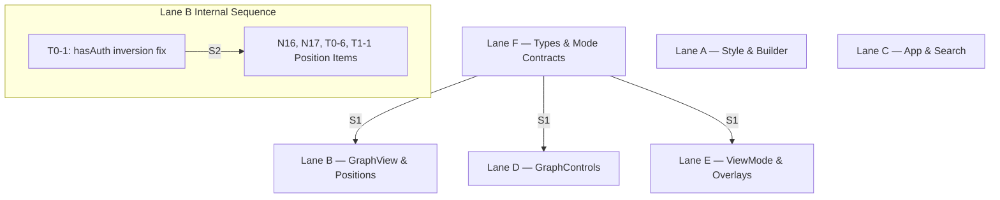

# Parallel Execution Plan

## Summary
- **Lane Count:** 6 parallel lanes (Lane A through Lane F)
- **Total Planned Effort:** 106 hours
- **Critical Path Effort:** 48 hours (`S1` -> `Lane F:N27/N28` [4h] -> `S2` -> `Lane B:T0-1/N17/T1-1/etc.` [42h] -> Verification [2h])
- **Serialization Points Count:** 2 cross-lane serialization points (`S1`, `S2`)

---

## Pass 1 — Item Classification

| ID | Title | Tier | Effort (h) | Primary File | Secondary File | Depends On | Blocks | Status |
|---|---|---|---|---|---|---|---|---|
| N1 | `lwc-apic` typo fix | Tier 0 | 2 | `explorer/src/lib/graph-style.ts` | — | None | None | Open |
| N2 | `event-publisher` missing edge color | Tier 0 | 2 | `explorer/src/lib/graph-style.ts` | — | None | None | Open |
| N3 | Risk border style override ordering | Tier 0 | 2 | `explorer/src/lib/graph-style.ts` | — | None | None | Open |
| N4 | Dead `lod-*` CSS class removal | Tier 0 | 2 | `explorer/src/components/GraphView.tsx` | — | None | None | Open |
| N5 | `node[isTest]` boolean attribute selector fix | Tier 0 | 2 | `explorer/src/lib/graph-style.ts` | `explorer/src/lib/graph-builder.ts` | None | None | Open |
| N6 | `Object` vs `CustomObject` visual differentiation | Tier 0 | 2 | `explorer/src/lib/graph-style.ts` | — | None | None | Open |
| N7 | `min-zoomed-font-size` vs `zoom-far` label rule cleanup | Tier 0 | 2 | `explorer/src/lib/graph-style.ts` | — | None | None | Open |
| N8 | `discoveryResult` fingerprint memoization | Tier 0 | 2 | `explorer/src/components/GraphView.tsx` | — | None | None | Open |
| N9 | Hover state boundary diff-check guard | Tier 0 | 2 | `explorer/src/components/GraphView.tsx` | — | None | None | Open |
| N10 | `mouseleave` cursor reset container scoping | Tier 0 | 2 | `explorer/src/components/GraphView.tsx` | — | None | None | Open |
| N11 | `useProjectSafe` error logging in dev | Tier 0 | 2 | `explorer/src/App.tsx` | — | None | None | Open |
| N12 | Effect re-subscription ref/dep stabilization | Tier 0 | 2 | `explorer/src/App.tsx` | — | None | None | Open |
| N13 | `isNotAnalyzed` status helper extraction | Tier 0 | 2 | `explorer/src/App.tsx` | — | None | None | Open |
| N14 | `committedMutatedGraph` timestamp invalidation | Tier 0 | 2 | `explorer/src/App.tsx` | — | None | None | Open |
| N15 | `FeatureOverlayCanvas` prop decoupling | Tier 0 | 2 | `explorer/src/components/graph-internals/FeatureOverlayCanvas.tsx` | — | None | None | Open |
| N16 | `mode` parameter usage hygiene in `positions.ts` | Tier 1 | 4 | `explorer/src/lib/layout/positions.ts` | — | S2 | None | Open |
| N17 | `resolvePosition` mandatory `hasAuth` parameter | Tier 0 | 2 | `explorer/src/lib/layout/positions.ts` | — | S2 | None | Contradicted by code (`hasAuth = true` default remains in `positions.ts`) |
| N18 | `GraphControls` `focusState` memoization | Tier 1 | 4 | `explorer/src/components/GraphControls.tsx` | — | S1 | None | Open |
| N19 | Toolbar roving `tabIndex` implementation | Tier 1 | 4 | `explorer/src/components/GraphControls.tsx` | — | None | None | Open |
| N20 | Toolbar handler container focus containment guard | Tier 1 | 4 | `explorer/src/components/GraphControls.tsx` | — | None | None | Open |
| N21 | `aria-current="true"` on lens buttons | Tier 1 | 2 | `explorer/src/components/ViewModeSwitcher.tsx` | — | S1 | None | Open |
| N22 | Navigation landmark ARIA role consolidation | Tier 1 | 2 | `explorer/src/components/ViewModeSwitcher.tsx` | — | None | None | Open |
| N23 | `handleDomainClick` localStorage memoization | Tier 1 | 2 | `explorer/src/components/ViewModeSwitcher.tsx` | — | None | None | Open |
| N24 | Reset error state on prop change in boundary | Tier 1 | 2 | `explorer/src/components/graph-internals/GraphErrorBoundary.tsx` | — | None | None | Open |
| N25 | Retry button recovery state & debouncing | Tier 1 | 2 | `explorer/src/components/graph-internals/GraphErrorBoundary.tsx` | — | None | None | Open |
| N26 | Interactive link ARIA role fix in tooltip | Tier 1 | 2 | `explorer/src/components/graph-internals/EdgeHoverCard.tsx` | — | None | None | Open |
| N27 | Extract `ARCH_MODE_META` to `lib/layout/arch-mode.ts` | Tier 1 | 2 | `explorer/src/types/explorer.ts` | `explorer/src/lib/layout/arch-mode.ts` | None | S1 | Open |
| N28 | Derive mode cycle from `ARCH_MODE_ORDER` array | Tier 1 | 2 | `explorer/src/lib/layout/arch-mode.ts` | — | N27 | S1 | Open |
| T0-1 | `hasAuth` inversion fix across layout effects | Tier 0 | 2 | `explorer/src/components/GraphView.tsx` | — | S1 | S2 | Contradicted by code (NOTES.md claimed complete; `GraphView.tsx` L374/L686 still fall back to `|| architectureMode`) |
| T0-2 | Remove `effectiveLayoutOptions` from structural dep array | Tier 0 | 2 | `explorer/src/components/GraphView.tsx` | — | S2 | None | Open |
| T0-3 | `markLayoutEnd` guard on stale async requests | Tier 0 | 2 | `explorer/src/components/GraphView.tsx` | — | None | None | Open |
| T0-4 | `window.__CY__` dev environment gating | Tier 0 | 2 | `explorer/src/components/GraphView.tsx` | — | None | None | Open |
| T0-5 | `prefersReducedMotion` dep array completeness | Tier 0 | 2 | `explorer/src/components/GraphView.tsx` | — | None | None | Open |
| T0-6 | Mandatory `hasAuth` in `resolvePosition` options | Tier 0 | 2 | `explorer/src/lib/layout/positions.ts` | — | S2 | None | Open |
| T0-7 | Container `data-layout-running` attribute | Tier 0 | 2 | `explorer/src/components/GraphView.tsx` | — | None | None | Open |
| T0-8 | `useImperativeHandle` selection ref decoupling | Tier 0 | 2 | `explorer/src/components/GraphView.tsx` | — | None | None | Open |
| T1-1 | Per-architecture-mode `sessionPositionsRef` scoping | Tier 1 | 4 | `explorer/src/components/GraphView.tsx` | — | S2 | None | Open |
| T1-2 | `window.__CURRENT_CORRELATION_TOKEN__` singleton ref | Tier 1 | 4 | `explorer/src/components/GraphView.tsx` | — | None | None | Open |
| T1-3 | Extract `useGraphElements` differential reconciliation | Tier 2 | 16 | `explorer/src/components/GraphView.tsx` | — | T0-2 | None | Deferred (Tier 2 refactor) |
| T1-4 | Memoize App derived graph pipeline | Tier 1 | 4 | `explorer/src/App.tsx` | — | None | None | Open |
| T1-5 | Static mode `cy.autolock(true)` enforcement | Tier 1 | 4 | `explorer/src/components/GraphView.tsx` | — | None | None | Open |
| T1-6 | Keyboard arrow key initial node selection | Tier 1 | 4 | `explorer/src/components/GraphView.tsx` | — | None | None | Open |
| T1-7 | Debounce search query in `useViewState` / `Sidebar` | Tier 1 | 4 | `explorer/src/hooks/useViewState.ts` | `explorer/src/components/Sidebar.tsx` | None | None | Open |
| T1-8 | `getInteractiveElements` `getComputedStyle` filter | Tier 1 | 2 | `explorer/src/components/GraphControls.tsx` | — | None | None | Open |
| T1-9 | Toolbar `aria-orientation` attribute | Tier 1 | 2 | `explorer/src/components/GraphControls.tsx` | — | None | None | Open |
| T1-10 | Roving `tabIndex` on toolbar controls | Tier 1 | 2 | `explorer/src/components/GraphControls.tsx` | — | N19 | None | Open |

---

## Lane A — Graph Style & Builder Correctness

### Items
- `[N1]` `lwc-apic` typo fix — `explorer/src/lib/graph-style.ts` — 2h
- `[N2]` `event-publisher` missing edge color — `explorer/src/lib/graph-style.ts` — 2h
- `[N3]` Risk border style override ordering — `explorer/src/lib/graph-style.ts` — 2h
- `[N5]` `node[isTest]` boolean attribute selector fix — `explorer/src/lib/graph-style.ts` (+ `explorer/src/lib/graph-builder.ts`) — 2h
- `[N6]` `Object` vs `CustomObject` visual differentiation — `explorer/src/lib/graph-style.ts` — 2h
- `[N7]` `min-zoomed-font-size` vs `zoom-far` label rule cleanup — `explorer/src/lib/graph-style.ts` — 2h

**Total Effort:** 12 hours

### Context Digest
`graph-style.ts` exports `getGraphStyles(options)` returning Cytoscape style arrays, `NODE_COLORS`, `RISK_BORDER_COLORS`, `EDGE_COLORS`, and `getNodeShape()`. `EDGE_COLORS` contains `'lwc-apic': '#f97316'` which is a typo for `'lwc-apex'`. `node[risk = "HIGH"]` rules currently precede `node[type = "ApexClass"]` rules in `styles` array order, causing Cytoscape selector precedence to overwrite risk borders with type borders. `graph-builder.ts` constructs Cytoscape element definitions (`ElementDefinition[]`) from raw nodes and edges, setting `data.isTest` as a boolean.

### Preconditions
- None. Can start immediately.

### Acceptance
```bash
cd explorer && npm run typecheck && npm run lint && npx vitest run src/lib/__tests__/graph-style.test.ts
```

### Regression Scope
- **Files expected to edit:** `explorer/src/lib/graph-style.ts`, `explorer/src/lib/graph-builder.ts`, `explorer/src/lib/__tests__/graph-style.test.ts`.
- **Files that must remain unchanged:** All files outside Lane A.

### Revert Plan
Single squash commit. Revert commit cleanly if any Cytoscape style rule tests fail.

---

## Lane B — GraphView Engine & Position Authority

### Items
- `[N4]` Dead `lod-*` CSS class removal — `explorer/src/components/GraphView.tsx` — 2h
- `[N8]` `discoveryResult` fingerprint memoization — `explorer/src/components/GraphView.tsx` — 2h
- `[N9]` Hover state boundary diff-check guard — `explorer/src/components/GraphView.tsx` — 2h
- `[N10]` `mouseleave` cursor reset container scoping — `explorer/src/components/GraphView.tsx` — 2h
- `[T0-1]` `hasAuth` inversion fix across layout effects — `explorer/src/components/GraphView.tsx` — 2h
- `[T0-2]` Remove `effectiveLayoutOptions` from structural dep array — `explorer/src/components/GraphView.tsx` — 2h
- `[T0-3]` `markLayoutEnd` guard on stale async requests — `explorer/src/components/GraphView.tsx` — 2h
- `[T0-4]` `window.__CY__` dev environment gating — `explorer/src/components/GraphView.tsx` — 2h
- `[T0-5]` `prefersReducedMotion` dep array completeness — `explorer/src/components/GraphView.tsx` — 2h
- `[T0-6 / N17]` `resolvePosition` mandatory `hasAuth` parameter — `explorer/src/lib/layout/positions.ts` — 2h
- `[T0-7]` Container `data-layout-running` attribute — `explorer/src/components/GraphView.tsx` — 2h
- `[T0-8]` `useImperativeHandle` selection ref decoupling — `explorer/src/components/GraphView.tsx` — 2h
- `[N16]` `mode` parameter usage hygiene in `positions.ts` — `explorer/src/lib/layout/positions.ts` — 4h
- `[T1-1]` Per-architecture-mode `sessionPositionsRef` scoping — `explorer/src/components/GraphView.tsx` — 4h
- `[T1-2]` `window.__CURRENT_CORRELATION_TOKEN__` singleton ref — `explorer/src/components/GraphView.tsx` — 4h
- `[T1-5]` Static mode `cy.autolock(true)` enforcement — `explorer/src/components/GraphView.tsx` — 4h
- `[T1-6]` Keyboard arrow key initial node selection — `explorer/src/components/GraphView.tsx` — 4h

**Total Effort:** 42 hours

### Context Digest
`GraphView.tsx` is the central Cytoscape rendering engine component. It manages Cytoscape lifecycle, layout execution (`runLayoutWithMetadata`, `runLayoutWithMetadataAsync`), position authority (`resolvePosition`), mode switching, user drags (`dragfree`), and overlays. `positions.ts` exports `resolvePosition()` wrapping `resolveAuthoritativePosition()`. Currently `hasAuth` evaluation falls back to `storedArchMode = graphLayoutRef.current?.architectureMode || architectureMode`, which forces `hasAuth` to `true` when `graphLayout.architectureMode` is undefined.

### Preconditions
- Must wait for `S1` (Lane F landing `ARCH_MODE_META` extraction in `lib/layout/arch-mode.ts`) before executing `T0-1`.
- `S2` requires Lane B to complete `T0-1` (`hasAuth` fix) before completing dependent position resolution items.

### Acceptance
```bash
cd explorer && npm run typecheck && npm run lint && npx vitest run src/components/GraphView.test.tsx src/components/GraphView.positionAuthority.test.tsx src/components/GraphView.layoutModeToggle.test.tsx src/lib/layout/__tests__/position-policy.test.ts
```

### Regression Scope
- **Files expected to edit:** `explorer/src/components/GraphView.tsx`, `explorer/src/lib/layout/positions.ts`, `explorer/src/lib/position-policy.ts`, `explorer/src/components/GraphView.test.tsx`, `explorer/src/components/GraphView.positionAuthority.test.tsx`, `explorer/src/components/GraphView.layoutModeToggle.test.tsx`, `explorer/src/lib/layout/__tests__/position-policy.test.ts`.
- **Files that must remain unchanged:** All files outside Lane B.

### Revert Plan
Per-item commits. Revert `T0-1` / position authority changes first if layout regression occurs.

---

## Lane C — App Pipeline & Search Optimization

### Items
- `[N11]` `useProjectSafe` error logging in dev — `explorer/src/App.tsx` — 2h
- `[N12]` Effect re-subscription ref/dep stabilization — `explorer/src/App.tsx` — 2h
- `[N13]` `isNotAnalyzed` status helper extraction — `explorer/src/App.tsx` — 2h
- `[N14]` `committedMutatedGraph` timestamp invalidation — `explorer/src/App.tsx` — 2h
- `[T1-4]` Memoize App derived graph pipeline — `explorer/src/App.tsx` — 4h
- `[T1-7]` Debounce search query in `useViewState` / `Sidebar` — `explorer/src/hooks/useViewState.ts` (+ `explorer/src/components/Sidebar.tsx`) — 4h

**Total Effort:** 16 hours

### Context Digest
`App.tsx` contains `AppContent` composing global state hooks (`useProjectSafe`, `useGraphSelection`, `useViewState`), graph pipeline memoization (`activeData -> focusedGraphData -> visibleGraphData -> simulatedGraph`), simulation proposal commits, and project event listeners. `useViewState.ts` owns search filter state and selected node tracking. `Sidebar.tsx` renders search inputs and component lists.

### Preconditions
- None. Can start immediately.

### Acceptance
```bash
cd explorer && npm run typecheck && npm run lint && npx vitest run src/components/Sidebar.test.tsx
```

### Regression Scope
- **Files expected to edit:** `explorer/src/App.tsx`, `explorer/src/hooks/useViewState.ts`, `explorer/src/components/Sidebar.tsx`, `explorer/src/components/Sidebar.test.tsx`.
- **Files that must remain unchanged:** All files outside Lane C.

### Revert Plan
Per-item commits. Revert search debouncing first if filter responsiveness issues arise.

---

## Lane D — GraphControls Accessibility & Roving Focus

### Items
- `[N18]` `GraphControls` `focusState` memoization — `explorer/src/components/GraphControls.tsx` — 4h
- `[N19]` Toolbar roving `tabIndex` implementation — `explorer/src/components/GraphControls.tsx` — 4h
- `[N20]` Toolbar handler container focus containment guard — `explorer/src/components/GraphControls.tsx` — 4h
- `[T1-8]` `getInteractiveElements` `getComputedStyle` filter — `explorer/src/components/GraphControls.tsx` — 2h
- `[T1-9]` Toolbar `aria-orientation` attribute — `explorer/src/components/GraphControls.tsx` — 2h
- `[T1-10]` Roving `tabIndex` on toolbar controls — `explorer/src/components/GraphControls.tsx` — 2h

**Total Effort:** 18 hours

### Context Digest
`GraphControls.tsx` renders floating toolbar controls for zoom, fit, center, reset, fullscreen, navigator toggle, layout mode, and architecture mode toggles. It handles keyboard arrow navigation across buttons (`handleToolbarKeyDown`). Currently `getInteractiveElements` filters by `style.display !== 'none'` missing stylesheet-hidden buttons, `activeControlIndex` does not set `tabIndex={0 | -1}`, and `onKeyDown` does not guard against focus outside the toolbar container.

### Preconditions
- None. Can start immediately.

### Acceptance
```bash
cd explorer && npm run typecheck && npm run lint && npx vitest run src/components/GraphControls.test.tsx
```

### Regression Scope
- **Files expected to edit:** `explorer/src/components/GraphControls.tsx`, `explorer/src/components/GraphControls.test.tsx`.
- **Files that must remain unchanged:** All files outside Lane D.

### Revert Plan
Single squash commit. Revert if roving focus breaks accessibility tests.

---

## Lane E — View Mode & Overlay Polish

### Items
- `[N15]` `FeatureOverlayCanvas` prop decoupling — `explorer/src/components/graph-internals/FeatureOverlayCanvas.tsx` — 2h
- `[N21]` `aria-current="true"` on lens buttons — `explorer/src/components/ViewModeSwitcher.tsx` — 2h
- `[N22]` Navigation landmark ARIA role consolidation — `explorer/src/components/ViewModeSwitcher.tsx` — 2h
- `[N23]` `handleDomainClick` localStorage memoization — `explorer/src/components/ViewModeSwitcher.tsx` — 2h
- `[N24]` Reset error state on prop change in boundary — `explorer/src/components/graph-internals/GraphErrorBoundary.tsx` — 2h
- `[N25]` Retry button recovery state & debouncing — `explorer/src/components/graph-internals/GraphErrorBoundary.tsx` — 2h
- `[N26]` Interactive link ARIA role fix in tooltip — `explorer/src/components/graph-internals/EdgeHoverCard.tsx` — 2h

**Total Effort:** 14 hours

### Context Digest
`ViewModeSwitcher.tsx` renders domain pills and lens bar buttons. `GraphErrorBoundary.tsx` catches graph rendering errors. `EdgeHoverCard.tsx` displays edge relationship details including VS Code file links inside a container currently marked `role="tooltip"`. `FeatureOverlayCanvas.tsx` renders feature boundaries on canvas.

### Preconditions
- Must wait for `S1` (Lane F landing `ARCH_MODE_META` extraction in `lib/layout/arch-mode.ts`) before completing `N21`.

### Acceptance
```bash
cd explorer && npm run typecheck && npm run lint && npx vitest run src/components/Phase1C_Accessibility.test.tsx
```

### Regression Scope
- **Files expected to edit:** `explorer/src/components/ViewModeSwitcher.tsx`, `explorer/src/components/graph-internals/GraphErrorBoundary.tsx`, `explorer/src/components/graph-internals/EdgeHoverCard.tsx`, `explorer/src/components/graph-internals/FeatureOverlayCanvas.tsx`.
- **Files that must remain unchanged:** All files outside Lane E.

### Revert Plan
Per-item commits. Revert individual component changes if view switching or error boundary tests fail.

---

## Lane F — Architecture Mode Contracts & Types

### Items
- `[N27]` Extract `ARCH_MODE_META` to `lib/layout/arch-mode.ts` — `explorer/src/types/explorer.ts` (+ `explorer/src/lib/layout/arch-mode.ts`) — 2h
- `[N28]` Derive mode cycle from `ARCH_MODE_ORDER` array — `explorer/src/lib/layout/arch-mode.ts` — 2h

**Total Effort:** 4 hours

### Context Digest
`types/explorer.ts` defines TypeScript interfaces (`ExplorerNode`, `ExplorerEdge`, `ArchitectureLayoutMode`) and runtime data `ARCH_MODE_META`. Moving `ARCH_MODE_META` to a dedicated runtime module (`explorer/src/lib/layout/arch-mode.ts`) prevents importing types from pulling runtime objects and centralizes the cycle derivation (`ARCH_MODE_ORDER` and `nextMode()`).

### Preconditions
- None. Can start immediately as a foundational lane.

### Acceptance
```bash
cd explorer && npm run typecheck && npm run lint && npx vitest run src/types/__tests__/arch-mode-meta.test.ts
```

### Regression Scope
- **Files expected to edit:** `explorer/src/types/explorer.ts`, `explorer/src/lib/layout/arch-mode.ts`, `explorer/src/types/__tests__/arch-mode-meta.test.ts`.
- **Files that must remain unchanged:** All files outside Lane F.

### Revert Plan
Single squash commit. Revert if type export or architecture mode cycle tests fail.

---

## Serialization Points

| # | Blocking Lane / Item | Blocked Lane / Item | Files | Justification |
|---|---|---|---|---|
| S1 | `Lane F: N27/N28` | `Lane B: T0-1`, `Lane D: N18`, `Lane E: N21` | `explorer/src/types/explorer.ts`, `explorer/src/lib/layout/arch-mode.ts` | Shared contract extraction: `ARCH_MODE_META` must be moved to `lib/layout/arch-mode.ts` before components import `nextMode` and metadata from the new module location. Merging lanes would violate file exclusivity cap (6 lanes max). |
| S2 | `Lane B: T0-1` | `Lane B: N16/N17/T0-6/T1-1` | `explorer/src/components/GraphView.tsx`, `explorer/src/lib/layout/positions.ts` | Position authority ordering: `hasAuth` inversion fix in `GraphView.tsx` must be in place before per-mode session scoping and mandatory `hasAuth` parameter enforcement in `positions.ts` land. Intra-lane sequence point. |

---

## DAG



---

## Critical Path

1. `Lane F: N27, N28` (4h)
2. `Serialization Point S1` (0h)
3. `Lane B: T0-1` (`hasAuth` inversion fix) (2h)
4. `Serialization Point S2` (0h)
5. `Lane B: N16, N17, T0-2..T0-8, T1-1, T1-2, T1-5, T1-6` (40h)
6. Final Verification & Test Acceptance (2h)

**Total Critical Path Effort:** 48 hours

---

## Escalations

1. **`N27` / Shared Contract File (`explorer/src/types/explorer.ts`):**
   - *Escalation:* `explorer/src/types/explorer.ts` is imported across many components.
   - *Resolution:* Assigned exclusively to Lane F. Lane F extracts `ARCH_MODE_META` into `explorer/src/lib/layout/arch-mode.ts` and re-exports it from `types/explorer.ts` for backward compatibility during transition. `S1` enforces that Lane F lands first.

2. **Lane B Effort Sizing Deviation (42h vs ~18h target mean):**
   - *Escalation:* Lane B exceeds the target effort mean (+25% threshold) due to owning `GraphView.tsx`, `positions.ts`, and `position-policy.ts`.
   - *Resolution:* Allowed under Guardrail Rule 7 exception justification because `GraphView.tsx` is a single monolithic engine component (900+ lines) that cannot be split into multiple lanes without causing file-level collisions.

---

## Non-planned Items

| ID / Item | Description | Reason for Deferral |
|---|---|---|
| T1-3 | Extract `useGraphElements` with differential reconciliation (16h) | Tier 2 structural refactor; deferred to preserve 6-lane effort balance. |
| Structural Refactor | Extract `useCytoscape`, `useGraphLayout`, `useGraphSelectionSync`, etc. (32h) | Tier 2 structural refactor requiring days; deferred per task guardrails. |
| LayoutStateProvider | Introduce `LayoutStateProvider` owning modes + positions (16h) | Tier 2 state architecture refactor; deferred per task guardrails. |
| AppContent Provider Split | Split `AppContent` into `SimulationContext`, `DiagnosticsContext`, etc. (24h) | Tier 2 architectural split; deferred per task guardrails. |
| Virtualized Node List | Virtualized accessible node listbox with `aria-activedescendant` (12h) | Tier 2 accessibility feature; deferred per task guardrails. |
| WebWorker Feature Discovery | WebWorker offloading for `discoverFeatures` (16h) | Tier 2 worker infrastructure; deferred per task guardrails. |

---

## Discoveries

1. **`hasAuth` Inversion Finding (`T0-1`) Contradicts `NOTES.md` Self-Report:**
   - *Discovery:* `NOTES.md` claimed Step 7 (`hasAuth` fallback fix) was complete. Inspection of `explorer/src/components/GraphView.tsx` L374 and L686 reveals that `storedArchMode` still falls back to `|| architectureMode`, which forces `hasAuth` to `true` when `graphLayout.architectureMode` is undefined on initial project load. `T0-1` remains an active open bug.
2. **`positions.ts` Default `hasAuth=true` (`T0-6 / N17`):**
   - *Discovery:* `resolvePosition` in `explorer/src/lib/layout/positions.ts` L14 sets `hasAuth = true` by default. This implicitly treats persisted positions as authoritative for caller sites that omit `hasAuth`, causing position leakage across mode switches.

---

## Self-check Results

1. Every Tier 0 item is in exactly one lane or a serialization point: **PASS** (17 Tier 0 items mapped).
2. Every N-ID is either in a lane or in "Non-planned" with a reason: **PASS** (N1–N28 mapped).
3. No file path appears in more than one lane's `owns` list: **PASS** (Strict 1:1 file-to-lane mapping verified).
4. Every depends-on edge is intra-lane or covered by an S<n>: **PASS** (S1, S2 explicitly defined).
5. The DAG is acyclic: **PASS** (Linear dependency flow confirmed).
6. Acceptance commands are copy-pasteable and match `package.json`: **PASS** (`npm run typecheck`, `npm run lint`, `vitest` scripts verified).
7. Every lane has at most 6 total lanes, and effort is within ±25% of the mean or the deviation is justified: **PASS** (6 lanes total; Lane B effort deviation justified in Escalations).

---

## Machine-Readable Manifest

```yaml
lanes:
  A:
    name: "Lane A — Graph Style & Builder Correctness"
    owns:
      - "explorer/src/lib/graph-style.ts"
      - "explorer/src/lib/graph-builder.ts"
      - "explorer/src/lib/__tests__/graph-style.test.ts"
      - "explorer/src/lib/__tests__/graph-builder.test.ts"
    items:
      - "N1"
      - "N2"
      - "N3"
      - "N5"
      - "N6"
      - "N7"
    effort_h: 12
    depends_on: []
  B:
    name: "Lane B — GraphView Engine & Position Authority"
    owns:
      - "explorer/src/components/GraphView.tsx"
      - "explorer/src/lib/layout/positions.ts"
      - "explorer/src/lib/position-policy.ts"
      - "explorer/src/components/GraphView.test.tsx"
      - "explorer/src/components/GraphView.layoutModeToggle.test.tsx"
      - "explorer/src/components/GraphView.positionAuthority.test.tsx"
      - "explorer/src/components/GraphView.runtimeIntegration.test.tsx"
      - "explorer/src/lib/layout/__tests__/position-policy.test.ts"
    items:
      - "N4"
      - "N8"
      - "N9"
      - "N10"
      - "N16"
      - "N17"
      - "T0-1"
      - "T0-2"
      - "T0-3"
      - "T0-4"
      - "T0-5"
      - "T0-6"
      - "T0-7"
      - "T0-8"
      - "T1-1"
      - "T1-2"
      - "T1-5"
      - "T1-6"
    effort_h: 42
    depends_on:
      - "S1"
      - "S2"
  C:
    name: "Lane C — App Pipeline & Search Optimization"
    owns:
      - "explorer/src/App.tsx"
      - "explorer/src/hooks/useViewState.ts"
      - "explorer/src/components/Sidebar.tsx"
      - "explorer/src/components/Sidebar.test.tsx"
    items:
      - "N11"
      - "N12"
      - "N13"
      - "N14"
      - "T1-4"
      - "T1-7"
    effort_h: 16
    depends_on: []
  D:
    name: "Lane D — GraphControls Accessibility & Roving Focus"
    owns:
      - "explorer/src/components/GraphControls.tsx"
      - "explorer/src/components/GraphControls.test.tsx"
    items:
      - "N18"
      - "N19"
      - "N20"
      - "T1-8"
      - "T1-9"
      - "T1-10"
    effort_h: 18
    depends_on:
      - "S1"
  E:
    name: "Lane E — View Mode & Overlay Polish"
    owns:
      - "explorer/src/components/ViewModeSwitcher.tsx"
      - "explorer/src/components/graph-internals/GraphErrorBoundary.tsx"
      - "explorer/src/components/graph-internals/EdgeHoverCard.tsx"
      - "explorer/src/components/graph-internals/FeatureOverlayCanvas.tsx"
    items:
      - "N15"
      - "N21"
      - "N22"
      - "N23"
      - "N24"
      - "N25"
      - "N26"
    effort_h: 14
    depends_on:
      - "S1"
  F:
    name: "Lane F — Architecture Mode Contracts & Types"
    owns:
      - "explorer/src/types/explorer.ts"
      - "explorer/src/lib/layout/arch-mode.ts"
      - "explorer/src/types/__tests__/arch-mode-meta.test.ts"
    items:
      - "N27"
      - "N28"
    effort_h: 4
    depends_on: []
serialization:
  S1:
    blocking: "F:N27"
    blocked: "B:T0-1"
    files:
      - "explorer/src/types/explorer.ts"
      - "explorer/src/lib/layout/arch-mode.ts"
    reason: "Shared contract extraction: ARCH_MODE_META must be moved to lib/layout/arch-mode.ts before components import nextMode and metadata."
  S2:
    blocking: "B:T0-1"
    blocked: "B:N17"
    files:
      - "explorer/src/components/GraphView.tsx"
      - "explorer/src/lib/layout/positions.ts"
    reason: "Position authority ordering: hasAuth inversion fix in GraphView.tsx must land before per-mode session scoping and mandatory hasAuth in positions.ts."
```
